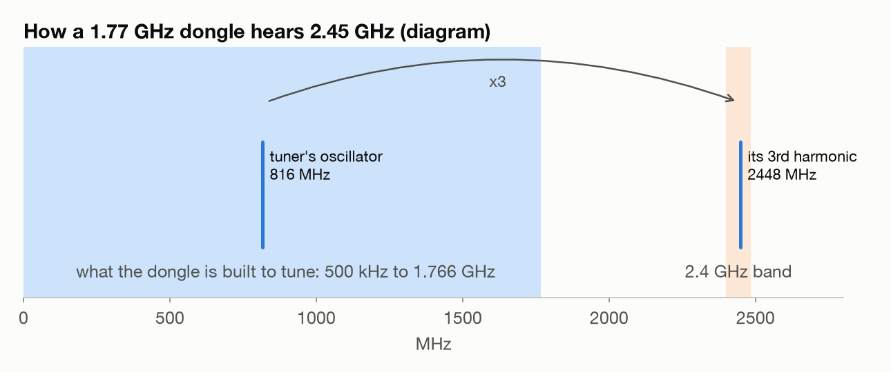
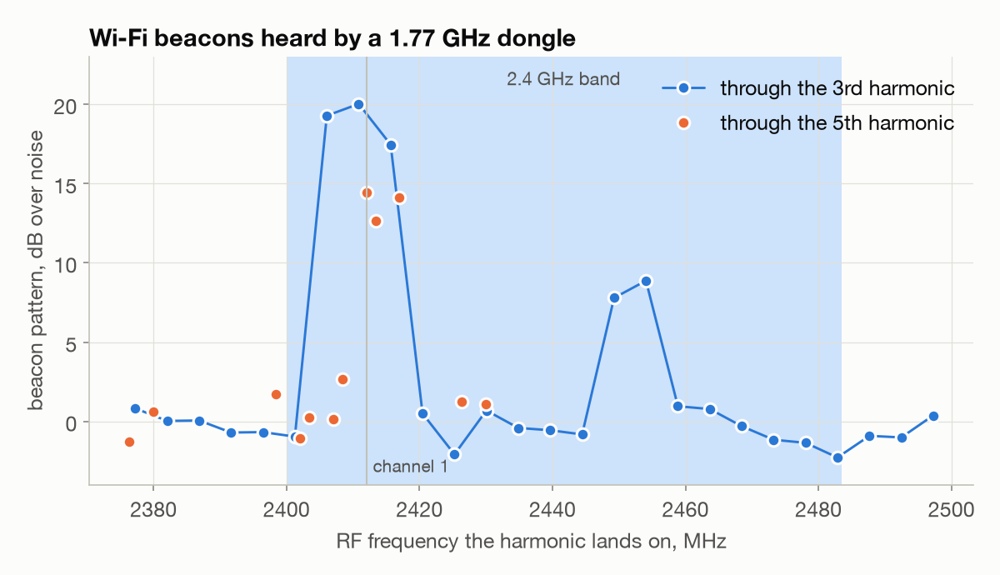
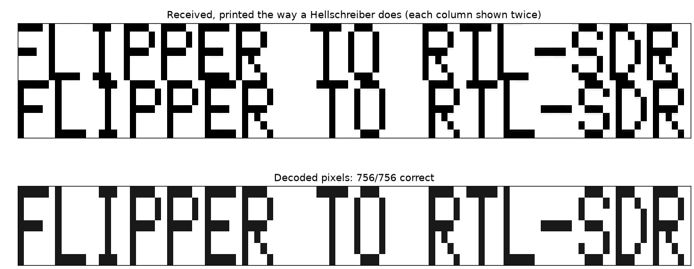
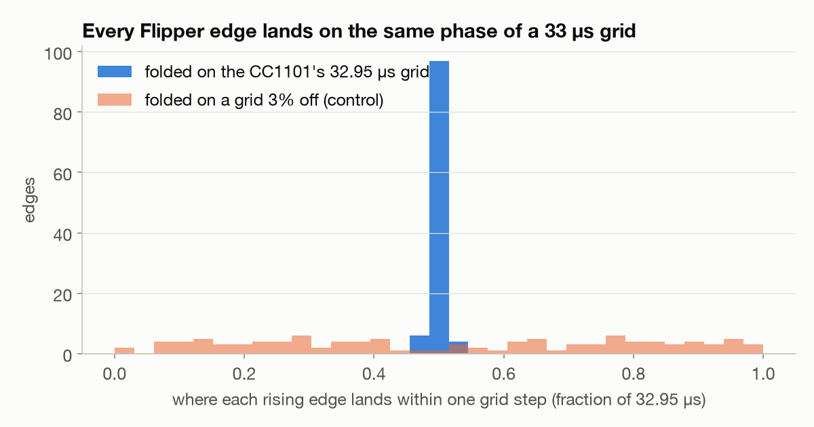
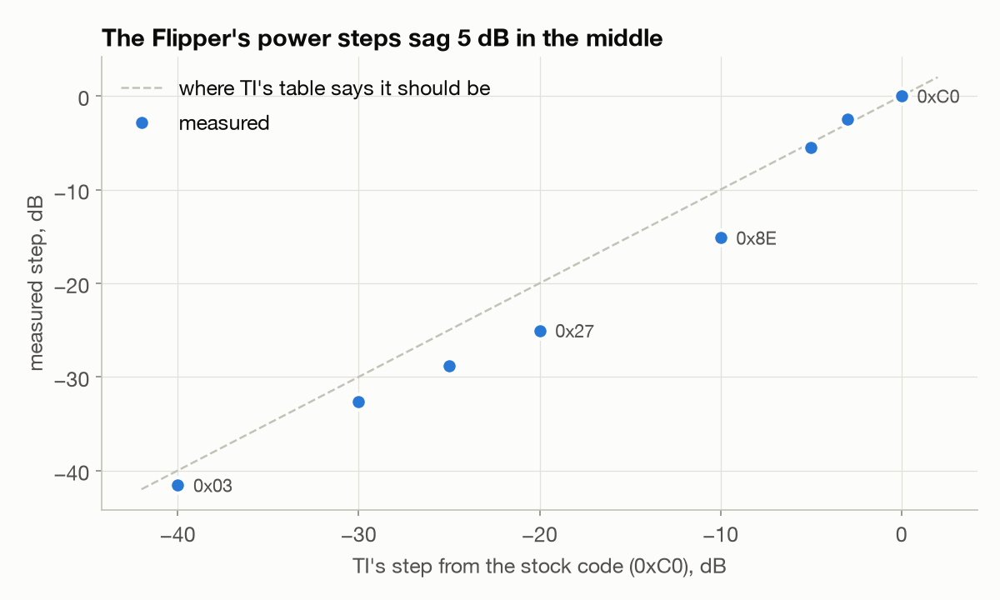
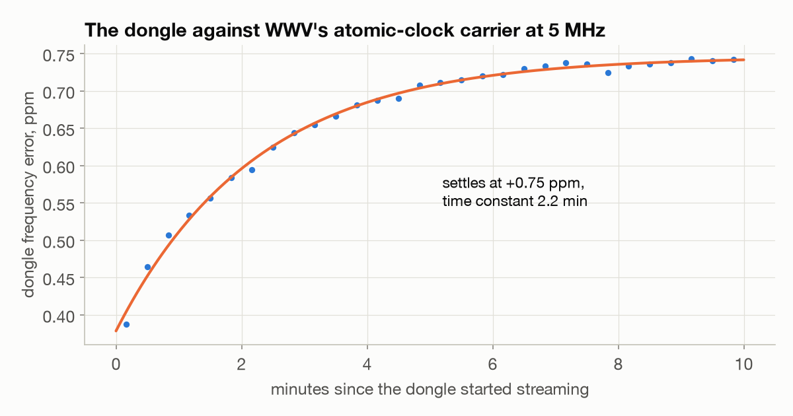
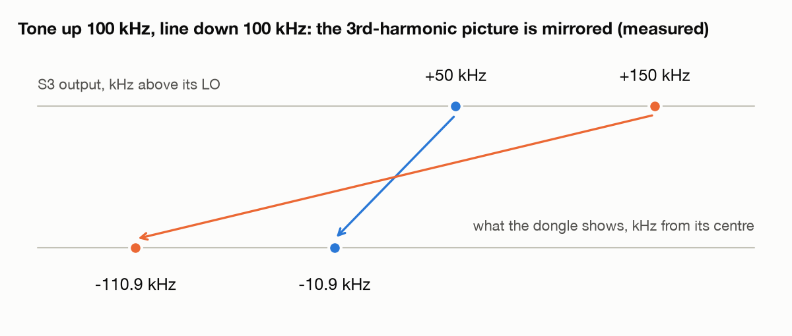
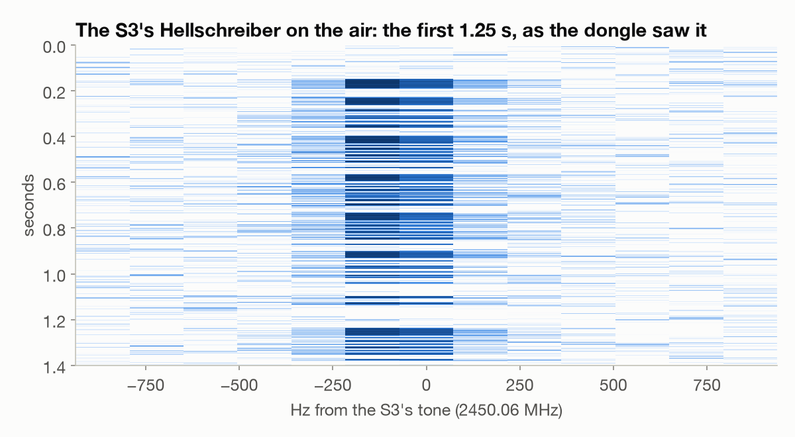
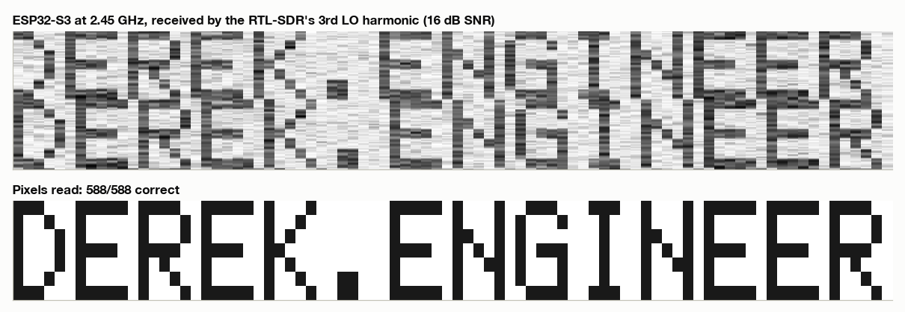
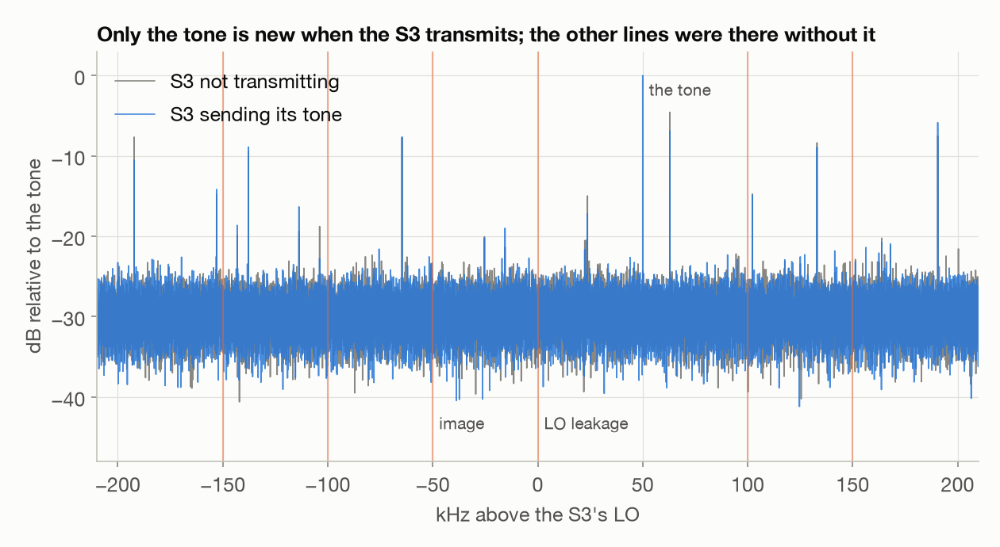

My first thought on reading Hackaday's
[ESP-SDR can now transmit](https://hackaday.com/2026/10/13/esp-sdr-can-now-transmit/)
was that my RTL-SDR could transmit now. It can't; it only receives. The
transmitter in the article is the ESP32 itself:
[new firmware](https://github.com/cyber-murmel/esp-sdr-zephyr) drives its Wi-Fi
radio sample by sample, so it sends whatever you hand it.

The ESP32-S3 in the article's demo is the same chip that runs my fan and
weather gateway, and I wanted to see the transmit side work with what was
already on my desk. The catch: the ESP32 transmits at 2.4 GHz, and the only
receiver I have stops at 1.77 GHz.

## Listening above the dongle's range

The RTL-SDR's tuner works by mixing the antenna signal with its own oscillator.
That mixer is driven hard, so besides the oscillator itself it also mixes with
the oscillator's odd harmonics, much more weakly. Tune the dongle to 814 MHz and
its oscillator sits near 816 MHz; three times that is 2448 MHz, and with the
tuner's 1.8 MHz IF on top, the dongle ends up hearing 2450 MHz. A transmitter on
the same desk is strong enough to make up for the loss.



Before transmitting anything, Claude checked the idea on the Wi-Fi around the
apartment. Access points send a beacon every 102.4 ms, a rhythm nothing at
800 MHz has, so it stepped the tuning so the third harmonic swept 2.37 to
2.49 GHz and looked for that 9.77 Hz pattern in the received power, after
checking the detector on synthetic data first. Channel 1 came in 17 to 20 dB
over the noise through the third harmonic, and 12 to 14 dB through the fifth
(tuned near 480 MHz instead). Every tuning that landed outside the band read
about zero.




At 2.4 MS/s, librtlsdr sets the R828D's IF to 1.815 MHz
([bandwidth code](https://github.com/osmocom/rtl-sdr/blob/v2.0.2/src/tuner_r82xx.c#L1055-L1108))
and puts the oscillator at the tuned frequency plus the IF
([source](https://github.com/osmocom/rtl-sdr/blob/v2.0.2/src/tuner_r82xx.c#L1143)).
Both harmonics fit RF = n × tuned + 4 × IF, so to look at f through the third
harmonic, tune to (f − 7.26 MHz) / 3:

```
rtl_sdr -f 814263300 -s 2400000 -g 49.6 -n 19200000 s3.cu8    # 2450.05 MHz, 8 s
```


## A dry run with the Flipper

Before borrowing the gateway, the [Flipper Zero](https://flipper.net/) stood in
for the ESP32. The article's demo uses
[Hellschreiber](https://en.wikipedia.org/wiki/Hellschreiber), a 1920s
teleprinter mode that draws text as columns of pixels, each pixel sent as the
carrier on or off for about 4 ms. The receiver prints the columns as a strip,
twice over, so a timing slip can't cut letters in half. Claude wrote an encoder
that turns text into a Flipper raw file, and a decoder for the dongle. The
Flipper sent "FLIPPER TO RTL-SDR" at 915 MHz, well away from 433.92 MHz so my
fan and the gateway never saw it, and the dongle read all 756 pixels.



The recording showed something about the Flipper's
[CC1101](https://www.ti.com/product/CC1101) radio too. Its on/off edges were
scattered by about 10 µs around where the file put them, which looked like
jitter until we folded them onto a grid. In this mode the CC1101 samples its
data pin at eight times the programmed data rate
([datasheet](https://www.ti.com/lit/ds/symlink/cc1101.pdf), section 27.1), and
the Flipper's OOK preset sets 3.79 kBd, so every edge snaps to a 32.95 µs grid.
All 214 edges land on the same phase of it:



Two more things fell out while the Flipper was transmitting. Its carrier sat
about 5 kHz high at 915 MHz, a +5 ppm crystal, and one register write (FSCTRL0,
the CC1101's frequency offset, 1.587 kHz per step) brought it within 0.2 kHz.
And its power steps don't match TI's table in the middle. Sending each PATABLE
code at or below the stock power and measuring the received level, the codes TI
rates at 0 and −10 dBm came out 5 dB lower. A control at three receiver gains
says that's the Flipper, not the dongle.



## Calibrating the dongle first

To trust a frequency error on someone else's crystal, I needed the dongle's
own. WWV's 5 MHz carrier comes off an atomic clock, so Claude recorded it for
ten minutes from a cold start. The dongle reads 0.38 ppm fast when it's cold
and settles at 0.75 ppm fast, with a 2.2-minute time constant. The crystal
numbers in this post are corrected for it.



## The ESP32 transmits


I unplugged the [Waveshare ESP32-S3-ETH](https://www.waveshare.com/esp32-s3-eth.htm)
from PoE, plugged it into the Mac and set it next to the Flipper. Before
flashing anything, Claude read the whole 16 MB flash back to the Mac and checked
it against the chip region by region, so the gateway could come back exactly as
it was. The board turned out to be wired to the S3's own USB port, which the SDR
firmware needs, and ESP-SDR's build for the XIAO ESP32S3 ran on it unchanged.

First a plain tone, 50 kHz above the S3's oscillator, at its weakest power step.
It came in 30 dB over the noise through the dongle's third harmonic. Moving the
tone up 100 kHz moved the dongle's line down 100 kHz, so the picture comes out
mirrored, which the harmonic model predicted: the third harmonic picks up the
opposite sideband from normal reception. The tone also put the S3's crystal at
+5.2 ppm.



Then Hellschreiber. Claude turned the text into a file of I/Q samples at
250 kS/s, and ESP-SDR's `esdr_usb` streamed it over USB to the S3, which played
it out of its Wi-Fi radio's DAC at 2.45 GHz, on the weakest power step again.
This is what the dongle saw on the air:



The first message, "ESP32 TO RTL-SDR", came through 672 of 672 pixels. Then I
asked for "derek.engineer" (the font is upper case only):



588 of 588 pixels, 16 dB SNR. ESP-SDR receives too: at 2412 MHz, the S3 itself
picked up the same channel 1 beacons the dongle heard through its harmonic.

## How clean the transmitter is

A transmitter asked for one tone also leaks a little of its oscillator, and a
mirror image of the tone from I/Q imbalance. Comparing the spectrum with the S3
sending its tone against the same spectrum with the S3 off, only the tone is
new. The leftover oscillator, the image and the products further out are all at
least 25 dB down. So are copies of the tone 250 kHz away, which stretching
250 kS/s up to the DAC's 40 MS/s can leave behind (at least 23 dB down). That's
as far as this measurement can see at the weakest power step, not a spec.



## What went wrong

- `esdr_usb tx -f 2450e6 -G 0 -i file` ignored every option after `tx`. On
  macOS, `getopt` stops at the first argument that isn't an option, so the
  first attempt sent a plain carrier for 10 seconds at the default power step 4
  instead of my file on step 0. Still weak and still in the band, but not what I
  meant to send. The options go before the command.
- The first decodes came back blank. The receiver picked its frequency from the
  spectrum averaged over the whole recording, and a steady spur beats a signal
  that's only on a third of the time. It also used a 10 kHz filter for a signal
  that needs a few hundred hertz. A peak-hold search and a ±600 Hz filter fixed
  both.
- The S3 rebooted itself four times: once during a long tone, three times some
  time after a transmission had ended. Each was a software reset with no fault
  recorded. Without a way to reproduce it with logs, I'm not reporting it.

## Putting the gateway back

On ESP-SDR's shell, `usj` hands the USB port back to the chip's built-in
USB-serial, and esptool wrote the backup back in 30 seconds, hash checked on the
chip. The gateway was online and decoding the weather sensors again within
minutes.


```
esptool --chip esp32s3 -p /dev/cu.usbmodem212301 -b 921600 read-flash 0 ALL s3eth-omg.bin   # backup first
west flash -d build-s3                                                                     # ESP-SDR multiapp
esdr_usb -f 2450e6 -r 250e3 -b 8 -G 0 -i hell.cs8 -t 4 tx                                  # options before tx
esptool --chip esp32s3 -p /dev/cu.usbmodem212301 -b 921600 write-flash 0 s3eth-omg.bin     # restore
```


## Still to try

- The S3's higher power steps, a few at a time.
- The other modulations in the firmware: a QAM/OFDM packet link and 802.15.4.
- Whatever makes the S3 reboot, if it ever reproduces with logs.

---

*[How this was built](/how-i-work/): Claude Code wrote the Hellschreiber encoder and decoder, the capture and analysis scripts and the figures, built ESP-SDR, backed up and restored the gateway's flash, and drafted this post from our session logs. I picked the article and the hardware, lent the gateway's ESP32-S3 and set it up next to the Flipper, chose the text it sent, pointed the night back at the transmit side when it drifted, and decided what was worth chasing. Tested: everything here was measured on the dongle, the Flipper and the S3 on Oct 13 and 14. Not tested: the S3's higher power steps, its other modulations, and why it rebooted.*
