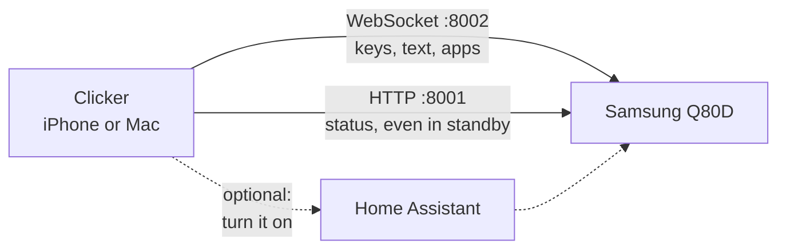

I'm always losing my TV remote.

I find it eventually, but my MacBook Air and my iPhone are almost always within arm's reach, so the remote should live on them. I also didn't want something tied to my setup: if it worked with anyone's Samsung TV, it could go on the App Store someday instead of being sideloaded every few months. The TV has a perfectly good remote. I just can't find it.

## How it talks to the TV

Mine is the 2024 Q80D from the [HDHomeRun app](/posts/samsung-tv-hdhomerun-app/). Samsung TVs take remote-control commands over a WebSocket on the local network. The first time a new app connects, the TV asks whether to allow it. After that it hands the app a token, and later connections are silent. A second address answers even in standby, with the TV's name, model, MAC address and current IP. That part turned out to matter.

Claude wrote the app in SwiftUI, one codebase for the iPhone and the Mac, with nothing in between: no server, no account.

The endpoints and messages are in the [repo's README](https://github.com/dcwfz9/clicker#how-it-works).

## The TV had moved

Claude's first move was to turn the TV on through [Home Assistant](https://www.home-assistant.io/), which already controls it. Nothing happened, and the TV didn't answer at its old address either. It had moved from 10.0.4.26 to 10.0.4.36. It has no DHCP reservation, so Home Assistant had been talking to an empty address until the TV came back on and it found it again.

So the app doesn't trust a saved address. Samsung TVs advertise AirPlay over Bonjour, so Clicker browses for that and asks each result for the standby address above. When the saved address stops answering, it looks for the same TV by its ID.

## Wake-on-LAN didn't wake it

Turning the TV on from standby is the hard part. Claude sent Wake-on-LAN packets to the TV's Wi-Fi MAC, once straight to its address and once as a broadcast, and checked it every two seconds for 20 seconds after each. It stayed in standby both times. [Home Assistant's docs](https://www.home-assistant.io/integrations/samsungtv/) say Wake-on-LAN has to be enabled on the TV itself, and I haven't checked that setting yet.

What does stay up in standby is the status address and the remote WebSocket. So the power button sends a Wake-on-LAN packet, then connects and sends the power key, then asks Home Assistant if that's set up. That works: the power button turns the TV on from standby. Which of the first two actually wakes it, I can't tell yet.

## Pairing without the remote

The first connection makes the TV ask whether to allow Clicker, and answering takes the remote, which was the whole problem. Claude tried pressing Allow through Home Assistant, which is already paired with the TV, and the prompt timed out anyway. So it kept reopening the prompt while I accepted it with a USB keyboard plugged into the TV.

My own builds now come with that token built in, so a reinstall connects without asking again.

## The app

One screen, no scrolling. Keys fire on touch-down, not on release, which is what makes it feel like a remote, and the arrows, volume and channel repeat while held. The d-pad is one circle cut into four wedges, so a thumb can land anywhere in one. Numbers, a keyboard for the TV's search box, the app list and settings are one tap away.

The first real test ran from the iPhone simulator on my Mac mini, against the real TV. It connected with the saved token, no prompt, and a mute press muted the TV. Claude checked by reading the mute state back from the TV over UPnP: muted after the first press, unmuted after the second. Since then I've used the Mac version to turn the TV on from standby, launch apps, and type into the TV's search bar.

## Getting it on my iPhone

This is where Apple's rules came in. A free Apple ID can install an app from Xcode, but it stops launching after seven days. The $99 developer account stretches that to a year, or gets it on the App Store. Then my new iPhone turned out to run iOS 27, which needs Xcode 27.1, which needs a newer macOS than my Mac mini runs. The update is downloaded, but installing it restarts the Mac mini, so the iPhone version is waiting on that.

## The Mac version

Same code, second target: a TV icon in the menu bar that drops the remote down, with the arrow keys, Return, Esc, M, and plus and minus working while it's open. A Mac app built on my own machine runs without an Apple ID and never expires.

iCloud doesn't sync self-built apps, so Claude sent it to my MacBook Air with [Taildrop](https://tailscale.com/kb/1106/taildrop) and put a copy in iCloud Drive. Then I couldn't find the icon. My menu bar was full enough that the notch was hiding it, so Creative Cloud and a few others had to go.

Once it showed up, it looked wrong. The top row's five buttons needed more room than the 340-point popover had, so the whole remote slid to the right and the source button and channel rocker got cut off. Claude's own render had the same problem and it didn't notice. Smaller buttons on the Mac fixed it, and this time Claude checked by measuring the margins on each row instead of eyeballing a screenshot.

## Putting it on GitHub

It's at [github.com/dcwfz9/clicker](https://github.com/dcwfz9/clicker). Before it went public, Claude took my home's details out of the tracked files: IP addresses, Home Assistant entity names, my Apple team ID. It searched the whole history for the TV's pairing token and my Home Assistant token (neither was there), squashed it into one clean commit, and built a fresh clone with none of my local files to make sure someone else could. The [latest release](https://github.com/dcwfz9/clicker/releases/latest) has a ready-to-run Mac download. The iPhone version is build-it-yourself for now, since the App Store needs the $99 account.

## Still to test

- Which part wakes the TV: the Wake-on-LAN packet, maybe once it's switched on in the TV's settings, or the power key.
- The Home Assistant fallback.
- The iPhone version on my actual iPhone, after the macOS and Xcode updates.

---

*[How this was built](/how-i-work/): Claude Code wrote both apps, the scripts and the GitHub release, and ran the tests against the TV. I decided what it had to be: on the devices I always have nearby, with a clean UI, and not tied to my setup so anyone with a Samsung TV could use it. I asked for the Mac version, paired it with a USB keyboard, caught the off-center layout on my MacBook Air, tested it on the TV, and decided to make it public. Tested: pairing, reconnecting without the prompt and a mute press read back from the TV, from the iPhone simulator; turning the TV on from standby, launching apps and typing into the TV's search bar, with the Mac version. Not tested: which part wakes the TV, the Home Assistant fallback, and a real iPhone.*
