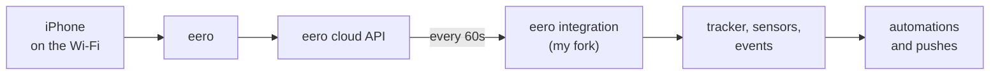

Home Assistant knows I'm home because my phone is on my eero. That comes from a custom integration, [schmittx/home-assistant-eero](https://github.com/schmittx/home-assistant-eero), since Home Assistant doesn't have an eero integration of its own. After I updated Home Assistant to [2026.11](https://www.home-assistant.io/blog/2026/11/04/release-202611/) this morning, its log said the integration would stop working in Home Assistant 2027.8, and its Wi-Fi QR code images were gone.

My presence runs on it: the kitchen air alerts only go out when I'm home, and the hallway motion alert only when I'm not. My phone's own location tracker missed me coming home too often, which is why the eero is in my presence setup at all. I'd rather fix it now than find out in August 2027.

## Nobody was merging

The last release was 1.8.1, in September 2025. Fifteen pull requests were open, several of them fixing exactly what I hit. The fixes existed; nobody was merging them.

A new integration made no sense. The existing one is about 7,200 lines of Python, and the hard part, eero's undocumented cloud API, is already worked out in it. It's MIT licensed, so I had Claude Code fork it: [dcwfz9/home-assistant-eero](https://github.com/dcwfz9/home-assistant-eero).

How it works: at setup you log in with a code eero sends you, and the integration keeps the session token. Every 60s (my setting; the default is 120) it pulls the whole account from eero's cloud: the network, every device eero knows, the eero units. The device tracker says home when eero lists my phone as connected. There's no local API, so when the internet is down, the integration is blind.

## What went in

Most of the fixes are other people's pull requests. Claude Code read every line of each diff before merging: the integration holds my eero session token, and this is code from strangers. None of it talks to anything but eero's API.

| PR | By | What it fixes or adds |
|---|---|---|
| [#186](https://github.com/schmittx/home-assistant-eero/pull/186) | theduderog | `via_device_id` instead of the deprecated `via_device`: the 2027.8 break, and the missing QR codes |
| [#170](https://github.com/schmittx/home-assistant-eero/pull/170) and [#169](https://github.com/schmittx/home-assistant-eero/pull/169) | ColinSummers | the device tracker on Home Assistant's newer zone model, and a `KeyError` on Python 3.14 |
| [#181](https://github.com/schmittx/home-assistant-eero/pull/181) | RavenX447l | a device that drops off eero's list goes unavailable instead of throwing an error every poll |
| [#184](https://github.com/schmittx/home-assistant-eero/pull/184) | lunaroja | setup is retried when eero's first refresh fails |
| [#187](https://github.com/schmittx/home-assistant-eero/pull/187) | ljlongwing | a Signal Bars sensor, eero's 0 to 5 score from the app |
| [#174](https://github.com/schmittx/home-assistant-eero/pull/174) | cmadds | band, channel and channel width on device trackers |
| [#173](https://github.com/schmittx/home-assistant-eero/pull/173) | cmadds | DHCP reservations: read them, set them, delete them |
| [#159](https://github.com/schmittx/home-assistant-eero/pull/159) | billda | names without the device name doubled: new installs get `sensor.office_status` instead of `sensor.office_office_status` (existing entity IDs stay as they are) |

Reading the diffs paid off once: #159 imports `UNDEFINED` from `homeassistant.const`, which Home Assistant 2026.11 doesn't have, so as merged the integration wouldn't load. The fork takes it without that import.

The QR codes had a second bug, [issue #183](https://github.com/schmittx/home-assistant-eero/issues/183), with no fix yet. pyqrcode encodes Latin-1 by default, and a network name typed on an iPhone usually has a curly apostrophe (’), which Latin-1 doesn't have, so it crashes. Claude Code switched it to UTF-8 and added escaping for the characters the Wi-Fi QR format reserves (`\ ; , " :`). To check, it decoded the new codes with [ZXing](https://github.com/zxing-cpp/zxing-cpp): a plain name, a curly apostrophe, a password made of every reserved character and an open network all came back exactly.

## What I added

I had Claude Code add four things, picked from a longer list:

1. **A push when a new device joins.** Every update already carries every device eero knows, connected or not, not just the two I track. The fork now saves the ones it has seen on each network and fires an `eero_new_device` event for a MAC address it hasn't. The first run recorded 36 devices without firing. A Home Assistant automation turns the event into a push with the name, maker, IP and which eero it's on. The eero app already does this; if this one holds up, I'll turn that off.
2. **DHCP reservations.** #173, plus a DHCP Reservations sensor that lists them all: 12 right now. Now Claude Code can reserve an address without me opening the eero app.
3. **Signal and band.** My iPhone: 5 bars, 6 GHz, channel 117.
4. **An outage log and a nightly speed test.** This part lives in Home Assistant, not the integration, because the integration can't see anything while the internet is down. Home Assistant's [ping integration](https://www.home-assistant.io/integrations/ping/) checks Cloudflare (1.1.1.1) and Google (8.8.8.8) every 30s, plus the eero itself (10.0.4.1). When both public ones fail for a minute, that's an outage. When either answers again, it goes in the logbook and I get a push like "Internet was down: 12 min, 11:02 AM to 11:14 AM", with whether the eero was answering the whole time. eero's own speed test runs at 4:07 AM, and the results go into the speed sensors' long-term history.

*Update, 2026-11-17: the first real new device joined last night, my new Apple Watch at 9:41 PM. Home Assistant's push and eero's own came in together. Mine says which eero it joined and the address it got; eero's names the network, which I've blacked out.*

## What didn't work

**Reserving an address that's already reserved.** Claude Code tested reservations on my air quality sensor, at the address it already had: create, read back, delete, read back, create again, each one checked against eero's own list. Then I asked it to rename my Pi 5's reservation, which I'd named "Obsidian" by mistake. eero answered `409 error.reservation.failed`. It refuses a second reservation for the same MAC and has no edit call, so #173's assumption that posting again would update it was wrong. Version 1.9.1 deletes the old reservation first and puts it back if eero refuses the new one. The Pi 5 is now "Pi 5".

**Room-level presence from the eero.** The device tracker already says which eero the phone is on. It said Office while I was sitting in the living room. Phones tend to stay on the eero they joined, so it isn't a room sensor. That needs a different approach, probably Bluetooth.

**macOS metadata.** The first copy of the files from the Mac brought 35 `._` files with it, the metadata macOS's tar adds. Diffing the installed copy against the repo caught it. `COPYFILE_DISABLE=1` keeps tar from doing that.

## Installing it the proper way

The first installs were Claude Code copying the files into `custom_components/eero` over SSH, which is all the Marketplace does too. But Home Assistant 2026.11 built HACS in as the Marketplace, and it still had the original down as installed: it would never offer my fork's updates, and an update to the original would have overwritten it. If other people are going to install this, I wanted to go through the same door they would.

The Marketplace won't let one repository take over another's folder ("The eero directory belongs to schmittx/home-assistant-eero"), and it won't uninstall the original while the integration is set up. So the proper way is the long way:

1. Take a backup of Home Assistant's config, so all of it can be undone.
2. Remove the eero integration.
3. Uninstall the original in the Marketplace, install the fork, restart.
4. Set eero up again: log in with the code eero emails, pick the network and the devices to track, then the same name and polling options as before.

The entities came back with the same IDs, so my automations kept working. Two things didn't come back on their own. Removing the integration also took the eero tracker out of my person, so presence quietly fell back to the phone's GPS, the setup that missed me coming home; Claude Code put it back. And the setup screens logged another deprecation: `show_advanced_options`, which Home Assistant removes in 2027.6. Version 1.9.2 always shows the advanced step instead, and it went in through the Marketplace's own update button, the way anyone else would get it.

## Future work

- Room-level presence with Bluetooth or mmWave radar, another day.
- Offer the QR and reservation fixes back to the original, in case it starts merging again.

---

*[How this was built](/how-i-work/): Claude Code forked the integration, read and merged the pull requests, wrote the QR code fix, the new-device event, the reservations sensor and the 1.9.1 reservation fix, set up the ping checks and the automations, installed each version on my Home Assistant, and did the Marketplace switch and the 1.9.2 fix. I asked whether we could fix the integration instead of living with it, chose a fork over a rewrite, picked what to add and what to skip (room presence failed my living room test, and I keep Thread on Home Assistant's own radio), insisted on installing it the proper way before publishing, did the setup again myself (the login and the choices), and checked the results in the eero app and on my phone. Tested: on my network with Home Assistant 2026.11.1: presence, the QR codes, reservations (create, delete, rename), the new-device push (a test event, then my new Watch joining), signal and band, the first nightly speed test (the next morning: 970 Mbit/s down, 44 up), the Marketplace install and its updates to 1.9.2 and 1.10.0, with my entity IDs unchanged. Not tested: a real outage.*
