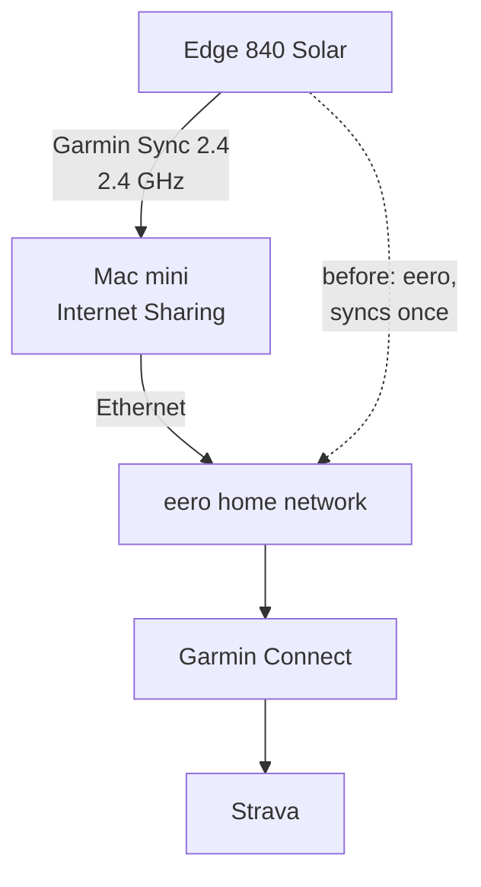

For about a year my [Edge 840 Solar](https://www.garmin.com/en-US/p/798946/) hasn't synced over Wi-Fi at home. It started in June 2025, the month I started at eero and brought home dogfood units. If I delete the network on the Edge and add it again, it syncs once. After that it sits on "connecting."

I want to bring the bike home, stop the ride, and find it on Strava without touching my phone. That's how it used to work. I've worked at both Garmin and eero, so I also wanted real data on whose bug this is.

<!-- PHOTO: the Mac mini on the desk next to the Edge, or the Edge showing a finished Wi-Fi sync. -->

## The fix

Edge 840 owners on Garmin's forums with the same symptom [fixed it](https://forums.garmin.com/sports-fitness/cycling/f/edge-840-series/415456/my-edge-840-won-t-reconnect-to-wifi-automatically) with a separate [2.4 GHz-only network](https://forums.garmin.com/sports-fitness/cycling/f/edge-840-series/418459/840-solar-will-not-sync-via-wifi). The Edge is 2.4 GHz only ([spec page](https://www8.garmin.com/manuals/webhelp/GUID-16B12CFE-F96E-4DE9-9F5F-8C4A5936D3B9/EN-GB/GUID-62D44DE6-9C4D-4834-8267-8B23F891A9F3.html)), and eero won't split its bands: one name everywhere, with only a [10-minute 2.4 GHz pause](https://support.eero.com/hc/en-us/articles/360049983772) for setting up devices. It isn't the usual WPA3 problem either ([an Edge 1040 owner](https://forums.garmin.com/sports-fitness/cycling/f/edge-1040-series/337704/no-wi-fi-since-fw-17-29) fixed theirs by putting the router back on WPA2 only); my eero is WPA2 only on 2.4 GHz.

So the Edge gets its own network from my Mac mini's Internet Sharing: Ethernet in, Wi-Fi out, named `Garmin Sync 2.4`. macOS put it on 2.4 GHz channel 11 by itself, and a scan of both bands found it only there. The Mac is wired, always on and sits on my desk. Sharing does take over its Wi-Fi (it drops off my home Wi-Fi while sharing), which doesn't matter since Wi-Fi was only its backup.

The tradeoff: nothing stops a client on that network from reaching my home network through the Mac, so it gets a stronger password.

## How I got there

I started with a Raspberry Pi 5 as the access point instead, because I wasn't sure what Internet Sharing would do to the Mac's own Wi-Fi, and because Linux gives me logs. Claude wrote the setup script (a NetworkManager hotspot plus a firewall that keeps clients off my home network) and read the logs while I ran tests on the Edge. What they showed:

- The Edge reconnected and synced on its own after restarting, the step that fails on eero. A ride I hadn't synced and a 55 MB software update went through.
- The Edge's "connection failed" message isn't reliable. It said that three times when the logs showed it connected within minutes, and Wi-Fi Sync worked right after.
- With the Pi's network moved to 5 GHz, the Edge never even tried to join, as the spec says. Without a usable network it gives up with "sync failed"; on eero it hangs on "connecting" instead, which suggests it finds the network there and gets stuck.
- With the Pi and the Mac both broadcasting the same name, the Edge picked one and synced, after a power cycle and after a short sleep. So two access points sharing a name isn't the trigger.

Then I moved the network to the Mac for good and gave the Pi back to its other plans.

## Garmin bug or eero bug

Both, probably. The timing points at eero, but Garmin shipped [27.14](https://forums.garmin.com/sports-fitness/cycling/f/edge-840-series/412922/edge-840-series-version-27-14---live) to the Edge 840 around the same time (May 27, 2025), and some owners date their trouble to the 27 updates. Everything else says the Edge is the fragile side: my eero networks are plain WPA2 on 2.4 GHz channel 1, every other device in the apartment handles them, and Garmin's [change logs](https://forums.garmin.com/sports-fitness/cycling/f/edge-840-series/422288/edge-840-series-version-28-34) keep fixing Wi-Fi. eero's part is a design choice: no 2.4 GHz-only network, which removes the workaround everyone else uses.

If I could ask each company for one thing: Garmin, keep syncing on a saved eero network like every other device does, and say why when you can't instead of sitting on "connecting." eero, an optional 2.4 GHz-only network name.

The exact trigger is still unknown: my two eeros share a channel, eero may be steering the Edge between them, or it's sleep. My theory is that a reboot re-initializes the Edge's Wi-Fi and a day or two of sleep between rides doesn't.

## Still to test

- A real ride after the Edge has slept a day or two, with nothing pressed.
- Auto upload right after saving: the trainer ride needed Wi-Fi Sync. Owners say a connected phone takes over.
- The Edge back on eero, now on new Garmin software, and on eeroOS 7.17.2 once it lands.

---

*[How this was built](/how-i-work/): Claude Code researched the forum reports and eero's docs, wrote the Pi's setup script and firewall, and read the Pi's and the Mac's logs during each test. I spotted the pattern, picked the hardware (the Pi first, then the Mac mini), set up Internet Sharing, ran every test on the Edge, came up with the sleep theory, and pushed on whether this is a Garmin bug. Tested: syncs through the Pi and through the Mac, reconnecting after a restart and after a short sleep, the 5 GHz and two-access-point checks. Not tested: a day or more of sleep, auto upload right after saving, the Edge back on eero with the new software.*
