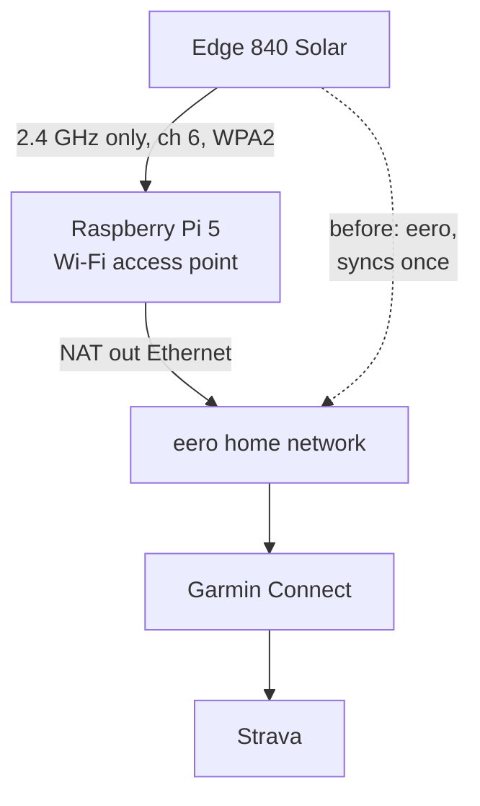
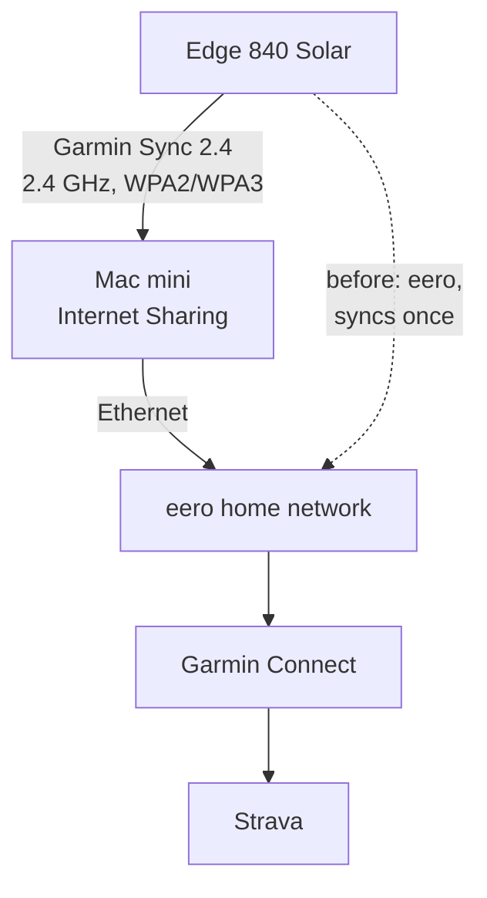

For about a year my [Edge 840 Solar](https://www.garmin.com/en-US/p/798946/) hasn't synced over Wi-Fi at home. It started in June 2025, the month I started at eero and brought home dogfood units (the pre-release eeros employees run at home). If I delete the network on the Edge and add it again, it syncs once. After that it sits on "connecting" and never transfers anything, even when I press Wi-Fi Sync.

I want to bring the bike home, stop the ride, and find it on Strava and Garmin Connect without touching my phone. That's how it used to work. I've worked at both Garmin and eero and still have friends at both, so I also wanted real data on whose bug this is instead of a guess.

<!-- PHOTO: the Mac mini on the desk next to the Edge, or the Edge showing a finished Wi-Fi sync. -->

## What the network looks like

My Wi-Fi is eero: two access points, my main network, and a guest network I'd named "Garmin Sync" in an earlier attempt to fix this. Claude scanned from the Pi: both names are on 2.4 GHz channel 1 and 5 GHz channel 116, from both access points, WPA2 only (no WPA3). So WPA3 transition mode wasn't it. That's the usual suspect for Garmin Wi-Fi trouble: an [Edge 1040 owner](https://forums.garmin.com/sports-fitness/cycling/f/edge-1040-series/337704/no-wi-fi-since-fw-17-29) traced a firmware update that broke Wi-Fi on routers running WPA2 and WPA3 together and fixed it by putting the router's 2.4 GHz band back on WPA2 only, and a [Forerunner 965 thread](https://forums.garmin.com/sports-fitness/running-multisport/f/forerunner-965/328658/wifi-network-not-found) points out that Garmin's own pages list only WPA and WPA2. (The main network is on 6 GHz too, where WPA3 is mandatory, but the Edge can't use that band.)

The Edge's radios are 2.4 GHz only: its [spec page](https://www8.garmin.com/manuals/webhelp/GUID-16B12CFE-F96E-4DE9-9F5F-8C4A5936D3B9/EN-GB/GUID-62D44DE6-9C4D-4834-8267-8B23F891A9F3.html) lists one wireless frequency, 2.4 GHz at 19.5 dBm. eero puts one network name across every band by design, and the only 2.4 GHz-only option is [a 10-minute pause](https://support.eero.com/hc/en-us/articles/360049983772) meant for setting up new devices ([no permanent split](https://support.eero.com/hc/articles/115005497223)). My guest network had the same shape as the main one, which is probably why it didn't help.

Other Edge 840 owners describe the same thing (none of them say what router they have):

1. [It works right after the network is re-added, then not after the Edge is switched off](https://forums.garmin.com/sports-fitness/cycling/f/edge-840-series/415456/my-edge-840-won-t-reconnect-to-wifi-automatically). The fix one owner reported: a 2.4 GHz-only network name.
2. [Auto upload quit after about a year](https://forums.garmin.com/sports-fitness/cycling/f/edge-840-series/418459/840-solar-will-not-sync-via-wifi), and a 2.4 GHz-only guest network brought it back.
3. [On 30.18 (2026)](https://forums.garmin.com/sports-fitness/cycling/f/edge-840-series/432386/wifi-sync-always-fails-on-30-18), re-adding the network "seems only to work for a while." No reply from Garmin in any of them.

## A 2.4 GHz network on the Pi

eero can't do a 2.4 GHz-only network, so the Edge needed one from somewhere else. I went through the hardware I had: an ESP32-S3-ETH (busy as my 433 MHz gateway), a plain ESP32 (saved for the TV backlight), the Mac mini, the UNO Q (no Ethernet) and the Pi 5. The Mac mini is wired and always on, so Internet Sharing was the obvious candidate, but I wasn't sure whether sharing over Wi-Fi would take the Mac's Wi-Fi full time, or whether the Mac could stay on my home Wi-Fi at the same time. So I started with the Pi 5: it's wired to the eero, its Wi-Fi radio wasn't doing anything, and Linux gives me logs. An ESP32 NAT router would have worked too, but with one radio its network has to follow the eero's channel.



Claude wrote a setup script for the Pi. What it sets up:

| | |
|---|---|
| Network name | `Garmin Sync 2.4`, 2.4 GHz only |
| Channel | 6 (the eero is on 1, the neighbors on 9 and 11) |
| Security | WPA2-PSK, AES only, no management frame protection, no fast roaming |
| Addresses | IPv4 only, NAT out the Pi's Ethernet, clients get 10.42.0.x |
| Firewall | clients get the internet and nothing else: no home network, nothing on the Pi but DHCP and DNS |
| Logs | every join, DHCP lease and DNS lookup, plus byte counters for what the Edge sends and receives |

The core of it is one [NetworkManager](https://networkmanager.dev/docs/api/latest/nmcli.html) connection:

```bash
nmcli con add type wifi ifname wlan0 con-name garmin-sync-ap ssid "Garmin Sync 2.4" \
  802-11-wireless.mode ap 802-11-wireless.band bg 802-11-wireless.channel 6 \
  802-11-wireless.powersave disable \
  802-11-wireless-security.key-mgmt wpa-psk 802-11-wireless-security.psk "<passphrase>" \
  802-11-wireless-security.proto rsn 802-11-wireless-security.pairwise ccmp \
  802-11-wireless-security.group ccmp 802-11-wireless-security.pmf disable \
  ipv4.method shared ipv6.method disabled
```

and an nftables table that loads before NetworkManager at boot, so the network never comes up without it:

```
table inet garmin_sync_ap {
	chain input {
		type filter hook input priority filter; policy accept;
		iifname "wlan0" ct state established,related accept
		iifname "wlan0" udp dport { 53, 67 } accept
		iifname "wlan0" tcp dport 53 accept
		iifname "wlan0" icmp type echo-request accept
		iifname "wlan0" counter drop
	}
	chain forward {
		type filter hook forward priority filter; policy accept;
		iifname "wlan0" ip daddr { 10.0.0.0/8, 100.64.0.0/10, 169.254.0.0/16, 172.16.0.0/12, 192.168.0.0/16 } counter drop
		iifname "wlan0" counter comment "uploaded by AP clients"
		oifname "wlan0" counter comment "downloaded by AP clients"
	}
}
```

Raspberry Pi OS keeps Wi-Fi blocked until a country is set, so the script also sets it to US.

Before the Edge touched it, Claude checked the network from my Mac mini's Wi-Fi: an address from the Pi, Garmin Connect loading, 48 Mbit/s down and 20 up (curl against Cloudflare's speed test), and Home Assistant timing out through the Pi while it loaded fine over Ethernet. Then a reboot, to make sure the firewall comes up before the network does.

## A "connection failed" that wasn't

The first time I added the network, the Edge said "connection failed." I figured it was a flaky connection and tried again: same message. Then I switched to a simpler password to rule out a typo, and still got "connection failed." The Pi's log told a different story: a few minutes later the Edge connected, got an address and looked up Garmin's servers (the 12:02 am row below), and a Wi-Fi Sync after that worked. It happened again the next morning: "connection failed," then the Pi's log showed it connected a minute later. And a third time, when I re-added the network for the test further down: "failed," then Wi-Fi Sync worked.

Just an artifact I found along the way, but worth knowing: the message on the Edge isn't proof the connection failed. Garmin has fixed a cousin of this before, in 27.13: "Fixed manual Wi‑Fi sync incorrectly reporting sync failure."

## What the Edge does on a network it likes

From the Pi's logs (times are mine, Pacific; the byte counters came in after the first session):

| When | What started it | Connected for | Up | Down | Garmin hosts it looked up |
|---|---|---|---|---|---|
| 12:02 am | first good join | 16 s | not counted | not counted | `clock`, `api.gcs`, `omt`, `download` |
| 5:31 am | re-added the network | 3 min 13 s | about 1.6 MB | about 55 MB | `clock`, `gold`, `api.gcs`, `download` |
| 5:41 am | nothing I pressed: the Edge restarting after a software update | 105 s | 243 KB | 942 KB | `connectapi`, `services`, `api.gcs`, Connect IQ, and `www.strava.com` |
| 7:41 am | Wi-Fi Sync, after a short trainer ride | 30 s | 181 KB | 804 KB | `clock`, `gold`, `download` |

The 55 MB was a software update. A ride I hadn't synced yet went up in the 5:31 session and the trainer ride in the 7:41 one, both showing up in Garmin Connect.

Two things changed. The Edge reconnected on its own after a restart, which is the exact step that fails on eero. And Wi-Fi Sync finishes now; on eero it got stuck connecting.

One thing didn't. After I saved the trainer ride, the Edge didn't try Wi-Fi at all: nothing in the Pi's log until I pressed Wi-Fi Sync. The manual only says auto upload sends the ride "as soon as you finish recording." Owners on the forums say the Edge uploads through the phone over Bluetooth instead when the phone is connected. I haven't tested whether that's what happened.

A detail for the Wi-Fi people: NetworkManager's access point offers both WPA2-PSK and PSK-SHA256 (it adds SHA256 even with management frame protection off), and the Edge picks SHA256: its handshake messages carry key descriptor version 3. I haven't checked what eero offers, or whether it matters.

## The 5 GHz test

Before blaming the shared name, I wanted to know whether the Edge can see 5 GHz at all. Claude moved the Pi's network to 5 GHz only (channel 36), same name and password, and checked it was up by joining it from my Mac on channel 36. Then I pressed Wi-Fi Sync on the Edge.

The Edge sat on "connecting" for a while, then said "sync failed." The Pi's log has nothing from the Edge in that window: not one association attempt. So it can't use a 5 GHz network even with the right name and password, which matches its spec page.

How it failed is the interesting part. On eero, Wi-Fi Sync sat on "connecting" and never changed (I never waited long enough to see it time out). Here it gave up with "sync failed." My guess is that on eero the Edge does find the network and gets stuck partway through connecting, instead of not finding it at all. That's from the message alone, not a capture.

## Two access points, one name

The second half of the plan was a same-name 5 GHz network next to the Pi's 2.4 GHz one, to copy eero's one name across bands. I turned on Internet Sharing on the Mac mini with the same name and password, but macOS wouldn't let me pick a channel and put its network on 2.4 GHz channel 11. That turned it into a copy of the other thing eero does: two access points with one name, like my two eeros. The Pi stayed on channel 6. One difference: the Mac offers WPA2 or WPA3, eero only WPA2.

From the Pi's logs and the Mac's own counters:

| What I did | Where the Edge went | What happened |
|---|---|---|
| Re-added the network | the Mac | "connection failed," then Wi-Fi Sync worked: about 66 KB up and 2 MB down |
| Full power cycle | the Pi (address 4 s after joining), then the Mac 24 s after it left the Pi | synced: about 290 KB up and 1.7 MB down on the Pi in 39 s, then 84 KB up and 1.5 MB down on the Mac in its first minute |
| 5-second sleep | the Pi (address in about a second) | synced: about 80 KB up and 800 KB down in 11 s |

Two access points sharing a name didn't break it, after a full power cycle or a short sleep. The Edge just picks one each time it connects.

## Garmin bug or eero bug

The timing points at eero. It started failing in June 2025, the month I brought home eero dogfood units, and it kept failing after I left eero this June and converted my network. But Garmin shipped [27.14](https://forums.garmin.com/sports-fitness/cycling/f/edge-840-series/412922/edge-840-series-version-27-14---live) to the Edge 840 around the same time (it went live May 27, 2025), and some owners in the threads above date their trouble to the 27 updates without naming a router. So the timing alone can't separate the two.

The rest points at the Edge as the fragile side. My eero networks are ordinary WPA2 on channel 1, which every other device in the apartment handles, and the Edge joins them fine right after the network is added. It's reconnecting later that fails. Garmin's own [Edge 840 change logs](https://forums.garmin.com/sports-fitness/cycling/f/edge-840-series/422288/edge-840-series-version-28-34) keep fixing Wi-Fi: 25.24 "Fixed adding a password protected WiFi network" and 27.13 "Fixed manual Wi‑Fi sync incorrectly reporting sync failure." My read: a Garmin Wi-Fi bug that something eero does sets off.

eero's part, as far as I can see, is a design choice, not a bug: one name for every band, and no permanent 2.4 GHz-only network. That removes the workaround every other Edge owner uses.

eeroOS 7.17.2 (October 7) says "Fixed an issue where certain devices couldn't connect with WPA2 encryption." It hasn't reached my network yet. My guess is it isn't this, since my problem is a year old and the Edge connects fine right after it's added, but that's untested.

If I could ask each company for one thing: Garmin, keep syncing on a saved eero network the way every other device in the house does, and when it can't, say why instead of sitting on "connecting." eero, an optional 2.4 GHz-only network name for devices like this.

What I can't pin down from here is the exact trigger. Two suspects are out: the shared name across bands (the Edge can't see 5 GHz) and two access points sharing a name (fine on channels 6 and 11). What's left: my two eeros sharing one channel, eero steering the Edge between them, something else in eero's beacons, or sleep. In real life the Edge sleeps a day or two between rides, and my theory is that a reboot re-initializes its Wi-Fi while a long sleep doesn't. A 5-second nap doesn't test that. The 2.4 GHz-only networks that fixed it for other owners probably changed several of these things at once, so their fix doesn't separate them either.

## Where it stands

The network lives on the Mac mini now. Internet Sharing does take the Mac's Wi-Fi full time: with it on, the Mac drops off my home Wi-Fi (macOS 26.2 shows its Wi-Fi disassociated, with the shared network on a separate interface). That doesn't matter, since the Mac is on Ethernet and Wi-Fi was only ever a backup. It's always on, it sits on top of my desk instead of tucked away like the Pi, so it probably reaches the bike better, and it's hardware I already run. The Pi 5 is back to its other plans.



The tradeoffs against the Pi: no firewall between that network and my home network, so it gets a stronger password; less logging (DHCP leases and data counts, no handshake detail); and the channel is macOS's call. [Apple's guide](https://support.apple.com/guide/mac-help/share-internet-connection-mac-network-users-mchlp1540/mac) only talks about a "default channel" you can change; mine came up on 2.4 GHz channel 11, the same default other people have reported for years. To make sure the Mac wasn't also broadcasting on 5 GHz, Claude scanned both bands from the Pi: the network showed up once, on channel 11, and nothing from the Mac's radio on 5 GHz (the same scan heard 22 other networks there). If macOS ever moves it to 5 GHz, the Edge won't see it.

Wi-Fi Sync works, and the Edge rejoins by itself after a restart and after a short sleep. The real test hasn't happened yet: a real ride after a couple of days asleep, saved at home, on Strava without me touching anything.

Future work:

- A real ride after the Edge has slept for a day or two, with nothing pressed. That's also the test of my sleep theory.
- Phone Bluetooth off versus on after saving, to see whether the phone path is why auto upload didn't fire after the trainer ride.
- Both access points on one channel, like my eeros.
- When eeroOS 7.17.2 lands, put the Edge back on eero with the Mac's network off and repeat the test.
- A Wi-Fi capture on channel 1 while the Edge hangs on eero.

---

*[How this was built](/how-i-work/): Claude Code went through the forum reports and eero's docs, scanned my Wi-Fi, wrote the setup script and the firewall, and read the Pi's logs to see what the Edge was doing. I spotted the pattern (it only syncs right after re-adding the network), set the rule of using hardware I already had, picked the Pi 5 and later moved it to the Mac mini, set up Internet Sharing, ran every test on the Edge (adding the network, Wi-Fi Sync, the trainer ride, the 5 GHz test, the power cycle and sleep with two access points), came up with the sleep theory, and pushed on whether this is a Garmin bug. Tested: the Edge joining the Pi's network, a software update, an unsynced ride and a trainer ride going up through it, the Edge reconnecting by itself after a restart, the Edge never trying to join a 5 GHz-only version of the network, the Edge rejoining and syncing with two same-name access points after a full power cycle and a 5-second sleep, syncs through the Mac mini's Internet Sharing, the Pi coming back after a reboot, and, with my Mac as the client, speed and the firewall keeping clients off my home network. Not tested: a sleep of a day or more, auto upload right after saving a ride, a ride with nothing pressed, two access points on one channel, eeroOS 7.17.2, and what exactly breaks on eero.*
