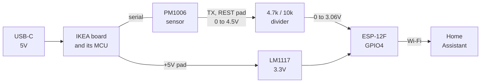
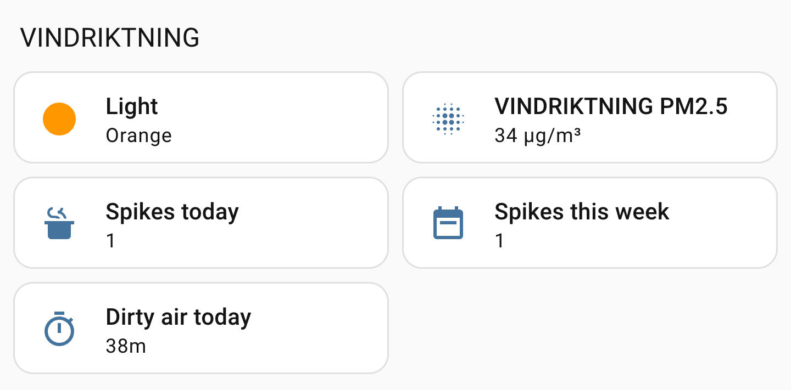

I already had a temperature and humidity sensor in Home Assistant, and I wanted particulates too.

I like the clean look of IKEA's VINDRIKTNING. IKEA stopped selling it, so I splurged a little on eBay: [$19.95 shipped](https://www.ebay.com/itm/177934820110), new in box. Everything else I already had: an ESP8266 from a college project, an LM1117 3.3V regulator, capacitors, resistors and wire from hobby projects, and the USB-serial cable I used to flash boards with. Once it showed up, all I had to do was solder it together. Figured it'd be a fun project to put things I already had to good use.

## How it works inside

The VINDRIKTNING is three things: a Cubic PM1006 particle sensor, a fan that pulls air through it, and IKEA's own board, whose microcontroller asks the sensor for a reading over serial and sets the light on the front. [Hypfer's project](https://github.com/Hypfer/esp8266-vindriktning-particle-sensor) found the trick everyone uses since: the sensor's transmit line comes out on a test pad, so an ESP8266 can listen in while the IKEA keeps working exactly as before.



The pad is labeled REST, which threw me, because on my ESP adapter board REST is the reset pin. It means reset here too. The row it sits in, ISPDA, REST, ISPCLK, GND and +5V, is the programming header for IKEA's microcontroller, an 8-pin Eastsoft ES7P001: data, reset, clock, ground and power. In the [ES7P001 datasheet](http://www.essemi.com/index/article/download?id=413) (Chinese) the reset shares a pin with the UART's receive line, and a configuration bit turns the reset off so the pin works as I/O. A commenter in [Hypfer's issue #10](https://github.com/Hypfer/esp8266-vindriktning-particle-sensor/issues/10#issuecomment-885419434) put it plainly: "The MRSTN pin is configured to be UART RX." It has to be, because a serial line sits at both levels: it idles high, and the sensor's 00 bytes hold it low for almost a millisecond each, so a working reset of either polarity would reboot the chip every reading. The ESP gets complete frames with valid checksums from that pad.

I thought about confirming it from the ESP: switch GPIO4 to an output, hold the pad low, and time how long the IKEA takes to come back. It doesn't work cleanly. The ESP only reaches the pad through the 4.7 kΩ, the sensor's own TX is driving that line, and while GPIO4 is driving it isn't listening. A cold start answers the come-back question anyway. The ESP and the IKEA power up together off the same USB-C, so Claude had the ESP record how long after its own boot the first reply shows up. On all three clean power-ups it was 4.1s, and that first reply already had real data in it. That's just inside the window Cubic's engineer described in the [Home Assistant forum thread](https://community.home-assistant.io/t/324599/300): "when the sensor doesn't receive a request within 5s after boot it will go into PWM mode."

## The parts

| Part | Job | Where it came from |
|---|---|---|
| [IKEA VINDRIKTNING](https://www.ebay.com/itm/177934820110) | sensor, fan, light, case, USB-C power | eBay, $19.95 shipped |
| AI-Thinker [ESP-12F](https://aithinker-static.oss-cn-shenzhen.aliyuncs.com/docs/Public%20Document%20Center/WiFi/esp8266/Specification/ESP-12F%20Specification-20220807.pdf) on a white adapter board ([ESP8266EX datasheet](https://www.espressif.com/sites/default/files/documentation/0a-esp8266ex_datasheet_en.pdf)) | Wi-Fi, listens to the sensor | a college project |
| [LM1117T-3.3](https://www.ti.com/lit/ds/symlink/lm1117.pdf) | 5V to 3.3V for the ESP | hobby drawer |
| 10 µF electrolytic capacitors | keep the LM1117 stable | hobby drawer |
| 4.7 kΩ and 10 kΩ resistors | divider on the data line | hobby drawer |
| Prolific PL2303 USB-serial cable | the first flash only | drawer |


## 5V sensor, 3.3V chip

The sensor runs on 5V, and its serial output swings between 0 and 4.5V ([PM1006 datasheet](http://www.jdscompany.co.kr/download.asp?gubun=07&filename=PM1006_LED_PARTICLE_SENSOR_MODULE_SPECIFICATIONS.pdf): "UART TX: 0~4.5V data output"). The ESP8266 runs on 3.3V. A digital input doesn't measure voltage, it compares: below 0.25 × VDD (0.83V) it reads a 0, above 0.75 × VDD (2.48V) it reads a 1, and in between it could read either. The [ESP8266EX datasheet](https://www.espressif.com/sites/default/files/documentation/0a-esp8266ex_datasheet_en.pdf) also caps any input at 3.6V. So the sensor's 0 is fine, and its 1 is 0.9V over the limit.

Two resistors fix that. 4.7 kΩ in series and 10 kΩ to ground divide the line by 1.47, so 4.5V arrives as 3.06V: 0.59V above the 1 threshold and 0.54V under the max. A 0 stays at 0V.


Hypfer wires the pad straight to the ESP, and his README says what he'd do about it: "if the ESP burns out after a while, just add a voltage divider or something." Plenty of people run it direct. I had the resistors, so mine stays in spec.

The divider doesn't slow anything down that matters. The pin sees about 3.2 kΩ (4.7k in parallel with 10k), and with a few picofarads on the pin that's an edge in the tens of nanoseconds, against 104µs per bit. That's an estimate, not a measurement.

The regulator has less room than it looks. The [LM1117 datasheet](https://www.ti.com/lit/ds/symlink/lm1117.pdf) gives a dropout of up to 1.2V at 100 mA, so from the IKEA's 5V there's about half a volt to spare. It also wants at least 10 µF on its output, with an ESR between 0.3 and 22 Ω, and 10 µF on its input. Mine are electrolytics.

## What's on the wire

The sensor talks plain UART: 9600 baud, 8 data bits, no parity, 1 stop bit. The line rests high. Each byte starts with a low start bit, then 8 data bits, least significant first, then a high stop bit, so a byte is 10 bits and takes 1.04ms. Per the datasheet, the IKEA board sends `11 02 0B 01 E1` to ask for a reading (the ESP only hears the other direction), and the sensor answers with 20 bytes.


That reply, decoded:

| Bytes | Here | Meaning |
|---|---|---|
| 1 | `16` | start of a reply |
| 2 | `11` | 17 more bytes before the checksum |
| 3 | `0B` | the command it answers |
| 4 to 19 | DF1 to DF16 | data. The datasheet defines one field: PM2.5 = DF3 × 256 + DF4, here `00 1C` = 28 |
| 20 | `A8` | checksum: all 20 bytes add up to 0x200, so the low byte is 0 |

The IKEA board doesn't ask once. In the ESP's log the replies come in bursts: 3 to 7 of them, 1 to 2s apart, every 20 to 30s. It only asks while its fan is running, which I found later by tapping the fan line.

## The bytes the datasheet skips

Three more fields aren't zero. Cubic, the sensor's maker, says they're off limits: "the DF7/8/11/12/13 are the Reserved byte" and "the reserved information is not open to customer" (their answer, quoted in [ESPHome feature request #1446](https://github.com/esphome/feature-requests/issues/1446#issuecomment-941137267)). In [Hypfer's issue #3](https://github.com/Hypfer/esp8266-vindriktning-particle-sensor/issues/3) people noticed the DF9-DF12 group follows the PM2.5 curve, guessed it was "some kind of raw uncalibrated value or similar", and found "DF5-DF8 are mostly constant".

Claude added those fields to Home Assistant as diagnostic sensors, published only from frames that pass the checksum, along with a running sum of the bytes that should stay zero. From the first evening's 25 frames, with PM2.5 between 22 and 138:

- **DF7-DF8** = 682 + 2.31 × PM2.5, within 3.3 counts on every frame. A big offset plus a slope looks more like the raw signal than DF11-DF12 does. Over a small range it barely moves, which is probably why it reads as "mostly constant" in that issue.
- **DF11-DF12** matched 0.96 × PM2.5, rounded, in 23 of 25 frames. "PM2.5 minus 1" only fits at low readings.
- **DF13** was always 1, and the other nine data bytes stayed at zero.

That's one evening on the bench. In the kitchen both held, with one twist: 81 minutes after I plugged it in, the sensor moved its own zero by 12, and DF16 started saying so ([below](#the-sensor-zeroed-itself)). Since then PM2.5 + 12 fits both formulas again: over the first day's 1,540 readings, DF7-DF8 stayed within 5.3 counts and DF11-DF12 within 2. The 682 didn't drift with the room either. Fitted hour by hour it stayed between 681 and 684 while the living room thermometer went from 66 to 69 °F.

## Flashing it once

The ESP-12F has no USB, so the first flash went over the PL2303 cable, with the cable's 5V going through the LM1117. Claude ran [esptool](https://github.com/espressif/esptool) from my Mac mini.

The first try failed with "No serial data received." I'd just plugged it in, without GPIO0 held low and without a reset, so the chip booted normally instead of into its bootloader. Then I remembered the routine from my college project days: hold GPIO0 to ground, power-cycle it, then flash. It went through on the next try.

Every update since has gone over Wi-Fi. ESPHome's [OTA updates](https://esphome.io/components/ota/esphome/) push a new build in 5 to 7 seconds with the case closed, and [safe mode](https://esphome.io/components/safe_mode/) covers a bad build: after repeated boot failures (ten by default) it boots with only logging, Wi-Fi and OTA running, so a fixed build can still get in. If it ever can't join my network it opens its own hotspot for new credentials.

The part of the config that does the work, minus the Wi-Fi and key boilerplate:

```yaml
uart:
  rx_pin: GPIO4
  baud_rate: 9600

sensor:
  # No update_interval: the IKEA board does the polling, the ESP only listens
  - platform: pm1006
    pm_2_5:
      name: "PM2.5"
```

ESPHome's [pm1006 component](https://esphome.io/components/sensor/pm1006/) does the decoding. Claude added the device to Home Assistant's ESPHome integration, which pulled the encryption key from the ESPHome add-on by itself.

## What the test pads do

I wanted to know what the colors on the front actually mean. The IKEA board has a second row of test pads labeled LED_G_I, PWM_Fan, LED_R_I, FAN- and FAN+. While the case was open I tacked temporary wires from three of them to spare ESP pins, and Claude had the ESP log how much of the time each line sat high, every half second. Then I went over the pads with a multimeter while candle and match smoke pushed the reading up through every color and back down.

| Pad | What it turned out to be | Multimeter |
|---|---|---|
| LED_G_I | the green LED, lit when the chip pulls it low | −0.03V green on, 4.96V green off |
| ISPCLK | the red and orange LEDs | 0.004V red, 4.7V orange, about 2.2V neither |
| LED_R_I | not red: the light sensor | 1.7 to 2.5V, drifting, no switching |
| PWM_Fan | the fan switch | about 5V running, about 0V stopped |

### Red isn't on the red pad

LED_R_I sat at a DC level that wandered when my hand or the probe got near it, and the meter's frequency mode read about 0 Hz. [Revspace's notes on the VINDRIKTNING](https://revspace.nl/VINDRIKTNING) explain it: they wired that pad to an analog input as the light sensor ("VINDRIKTNING LDR"), and the red and orange LED to the ISPCLK pad, the clock pin from the programming header.

ISPCLK is the interesting one. The meter reads 0V when the light is red, 4.7V when it's orange, and about 2.2V when it's green. That's one pin with three states. Pulled low, it lights an LED that runs from 5V down to the pin. Driven high, it lights an LED that runs from the pin down to ground. Left floating, neither has enough voltage across it, and the pin rests between them at about 2.2V. Revspace noticed that "the ESP8266 output voltage is not enough to light the orange LED", which fits: orange needs the pin pushed up to 5V.


### Every pin is used

The ES7P001 has 8 pins: power, ground and six lines. With the measurements and Revspace's notes, all six are spoken for:

| Line | Pad | Job |
|---|---|---|
| UART receive (shared with reset) | REST | the sensor's replies |
| UART transmit | ISPDA | requests to the sensor |
| I/O | LED_G_I | green LED |
| I/O, three states | ISPCLK | red and orange LEDs |
| I/O | PWM_Fan | fan |
| analog input | LED_R_I | light sensor |

So there was no pin left for a third LED, and orange shares a pin with red. That mapping is mine, from measurements and Revspace, not traced pin by pin on the board.

### The light dims itself

Revspace also says "there is a light-sensing element, that controls the brightness of the LED," and the green line shows it. In one hour that evening the green line sat high 89% of the time while the light was green, so the LED was lit 11% of the time. During the meter check it was lit 100% of the time. Red did the same: the meter once read ISPCLK at 1.98V with the light red, which is the meter averaging an LED that's on only part of the time, and later at 0V. I didn't turn the room lights off on purpose to prove it, so this is what the readings point to, not a test.

### The fan runs in bursts

The fan doesn't run all the time. PWM_Fan sits at 5V while it runs and drops to 0V for about 9s every 30s: 113 off stretches in an hour, starting a median 30s apart. Despite the name it's on or off, not a speed. The IKEA only asks the sensor for readings while the fan runs: 625 of the 681 replies in that hour came with the fan line high, and most of the rest landed on a switch. That fits a note in [Hypfer's issue #17](https://github.com/Hypfer/esp8266-vindriktning-particle-sensor/issues/17): "bursts of 7 samples with +/- 2 seconds in between, followed by a 10 seconds pause."

In the kitchen it kept that schedule all day: 2,928 stops in the first 24 hours, a median 9s off and 21s on, and 90% of them within half a second of that, which is as fine as the ESP samples the line.

## What the light means

[IKEA's manual](https://www.ikea.com/ca/en/manuals/vindriktning-air-quality-sensor__AA-2289325-2-100.pdf) gives the bands: "Green: 0-35", "Amber: 36-85", "Red: 86-". The light doesn't follow them exactly: going up it's a little late into orange, and coming down it waits.

| Change | Where it switched |
|---|---|
| green to orange | 38, as best I can tell: 35 and 36 stayed green, 39 went orange twice and 45 once |
| orange to green | 32 or below: 32, 31, 30, 29 (33 held orange for minutes) |
| orange to red | 86, per the manual: 85 stayed orange and 91 went red, nothing landed in between |
| red to orange | 80: 86, 82 and 81 held, 80 let go |

That's hysteresis: the light switches at a higher reading on the way up than on the way down. Red comes on at 86 and lets go at 80. Orange lets go at 32, and comes on somewhere from 37 to 39: on Saturday a reading of 36 left the light green. With the same 6-point gap as red, that's 38, so that's what my dashboard uses. Each switch landed within a second or two of the reading that crossed the line, so it isn't averaging either. The gap between the up and down points keeps the light from flickering when the readings sit near a line, and on the bench they bounced by a few µg/m³ from one burst to the next. Hypfer's README quotes an earlier report: "the transitions from Green to Yellow and Yellow to Red in the Ikea firmware are at around 30 and 100μg/m³." This is the same behavior, measured in both directions.

![Two panels of PM2.5 on a log scale during candle tests on the bench, shaded green, orange or red by the light's color. Top: green is read off the green LED line and orange vs red is filled in from the red thresholds; red when the smoke hits, orange as it clears, then orange at 39 twice and green again at 32, 30 and 31. Bottom: red is read off the red LED line and green vs orange is filled in from the green thresholds; red when the reading jumps to 115, still red at 86 and 82, orange at 79, then green once it falls to 32](figs/light-thresholds.png)

This part is fair to measure on the bench, even with the case open: the light and the ESP read the same sensor replies, so it's IKEA's logic, not the air.

## In Home Assistant

The sensor shows up through ESPHome with:

- **PM2.5**, every reading.
- **Light**: Green, Orange or Red, to match the light on the front. Red comes straight off the red LED line, so it's exact. Green vs orange comes from the readings with the thresholds above, since the ESP sees ISPCLK's 2.2V and 4.7V both as a 1.
- **Diagnostics**: the undocumented bytes, seconds from boot to the first reply, the reset reason, and while the test-pad wires are on, the red LED line and whether the fan is running.
- **Air spike**: on once the light has been orange or red for 2 minutes. While I'm home, 7 AM to 11 PM, Home Assistant turns it into a push to my phone, "Open a window or run the hood", and another when it clears, with how long it took. A reading over 150 while nobody's home sends a time-sensitive push instead.

On the dashboard, the light is a tile in the matching color next to PM2.5. There are three tiles, one per color, and each only shows while the light is that color. Home Assistant can't recolor a sensor's own icon without a custom card, so the color lives on the dashboard. Under them: how many spikes today and this week, and how long the air was dirty today.



The firmware side of the light, in the ESPHome config:

```yaml
script:
  - id: update_light
    then:
      - lambda: |-
          const float pm = id(pm25).state;
          if (std::isnan(pm)) return;
          const float red_line = id(led_red_line).state;
          const std::string cur = id(light_color).state;
          bool red;
          if (!std::isnan(red_line)) red = red_line < 95.0f;
          else red = pm >= 86 || (cur == "Red" && pm > 80);
          std::string next;
          if (red) next = "Red";
          else if (cur == "Orange" || cur == "Red") next = pm <= 32 ? "Green" : "Orange";
          else next = pm >= 38 ? "Orange" : "Green";
          if (next != cur) id(light_color).publish_state(next);
```

It runs on every reading and whenever the red line switches. One limit: right after the ESP restarts, a reading between 33 and 37, or between 81 and 85, starts as a guess, because in those ranges the color depends on which way the reading came from.

## What I haven't seen written down

As far as I could find, these aren't written down anywhere, at least not measured:

1. **How orange is made.** One pin, three states: pulled low for red, driven high for orange, floating for neither.
2. **The light's hysteresis.** It switches at different readings going up and coming down: orange at about 38 but green again only at 32, red at 86 but orange again at 80. No averaging: it switches within a second or two.
3. **The light dims with the room.** The light sensor sits on the pad named LED_R_I, and the green LED was lit 11% of the time in one hour and 100% in another.
4. **What DF7-DF8 tracks.** On this unit it's 682 + 2.31 × (PM2.5 + DF16), on the bench and through the first day in the kitchen.
5. **The fan's schedule.** Off 9s every 30s, all day, and the IKEA only asks for readings while it runs.
6. **The start-up timing.** The IKEA asks for its first reading 4.1s after power-up, just inside the sensor's 5s window.
7. **The sensor moves its own zero and says so.** Once on the first night, PM2.5 dropped by 12 in one reply while DF7-DF8 and DF11-DF12 held, and DF16 went from 0 to 12.

## Where it lives

It lives in the kitchen, on the top shelf of the bookshelf above the plants: same wall as the litter box but the opposite corner, and across the room from the stove. It's a good hidden spot, so it's not an eyesore, it's close to the litter box, and it's still in the kitchen for cooking. It'll give me an excuse to cook.

It went up there at 10:48 PM on November 12. The case is still open, with the test-pad wires on.

## In the kitchen

The datasheet sets expectations: ±20 µg/m³ or ±20% of the reading (at 25 °C and 50% RH), with the sensor's linearity verified against cigarette smoke. So the absolute numbers are rough. What a cheap sensor can still do well is change: spikes, how fast they clear, before and after.

![Two panels. Top: PM2.5 as reported over the first day in the kitchen, 10:48 PM on November 12 to 11:08 PM on November 13. It starts around 20 to 25, drops from 21 to 7 in one reading just after midnight, then sits around 5 to 7 with small blips, with two spikes from the oven door, 39 at 11:37 AM and 23 at 12:04 PM, and triangles along the bottom for the two litter box visits at 6:47 AM and 5:39 PM. Bottom: twenty minutes around 00:10, where the reported PM2.5 drops from 21 to 7 while DF11-DF12 only goes from 20 to 19.](figs/first-day.png)

### The sensor zeroed itself

At 00:09:58, 81 minutes after I plugged it in, the reading fell from 21 to 7 in one reply. The air didn't do that. DF11-DF12, which had been 0.96 × PM2.5 all evening, went from 20 to 19, and DF7-DF8 from 726 to 725. In the same reply DF13 went from 1 to 2, and DF16, one of the bytes that had always been zero, went to 12.

Since then PM2.5 + 12 fits the bench formulas again. So the sensor moved its own zero by 12 µg/m³, and DF16 says by how much. Cubic doesn't document any of it. My guess is an automatic zero correction. It isn't a simple timer: on the bench it ran over 100 minutes without doing it.

The reported number is still the reading. It's the only field the datasheet defines, and 12 is inside its ±20 µg/m³. DF11-DF12 is the uncorrected value, not a better one. The dashboard and the alerts use the reported number.

After that the night was quiet: 5 to 7 µg/m³ until morning, straight through the rain that started around 3 AM.

### Cooking and the litter box

The first cooking was a pizza in the oven. Preheating didn't register. Opening the door did, both times: 39 at 11:37 and 23 at 12:04, each back to single digits within a minute or two, with the reading a couple of points above the morning's in between. 39 is past the orange line, but only for about 7 seconds, nowhere near the 2 minutes the alert waits for.

The litter box doesn't show up, which is good news. Most visits moved the reading by a few µg/m³ at most. A few were followed by a jump, like 6 to 18 during Saturday morning's, but the reading jumps like that day and night, about once every 45 minutes, so none of them is clearly the cat.

### Setting off the alert

Nothing on the first day lasted the 2 minutes the alert waits for, so on Saturday afternoon I set it off on purpose: a tortilla toasted on the stove. The windows were open like always, the hood was on, and my air purifier by the litter box switched itself on. That's how the kitchen normally is, so the clear-down is the real one.

![PM2.5 on a log scale from 2:45 to 3:36 PM on November 14, over bands for the IKEA's light. It sits around 10 while the light is green, climbs past 36 and 91 within a minute, and pins at the sensor's ceiling of 1,000 from 2:53 while the light is red. A line at 2:53:45 marks the "Kitchen air is up" push. From about 2:55 it falls fast, a dotted fit labeled "halves every 3 min", then slower from about 120, a second fit labeled "then every 12 min". The light goes orange at 3:17 and green at 3:33, where a second line marks the "Kitchen air is clear again after 42 min" push.](figs/tortilla.png)

1. **2:51:11 PM:** the reading starts climbing from 11.
2. **2:51:45:** 36. The light on my dashboard went orange, but the IKEA's own light was still green. It was orange by 68. That's what moved my dashboard's orange line to 38 ([above](#what-the-light-means)).
3. **2:52:13:** red, at 91. That one's exact: it's the red LED itself, read off the board.
4. **2:53:09:** 1,000, the most the sensor reports. The real peak was higher.
5. **2:53:45:** two minutes after the light left green, the push: "Kitchen air is up (PM2.5 1000). Open a window or run the hood."
6. **3:17:** the red goes off. **3:33:** green, and the second push: "Kitchen air is clear again after 42 min."

It cleared at two speeds. From the ceiling down to about 120 it halved roughly every 3 minutes: the smoke spreading through the room and the hood pulling it out. After that it halved about every 12 minutes, so the last stretch, orange back to green, took the longest. (Those are exponentials fitted to each stretch, over a background of 8.) For scale, homes in [a Seattle study](https://pmc.ncbi.nlm.nih.gov/articles/PMC8026580/) had air exchange of 0.3 to 1.4 per hour and particles settling at 0.1 to 0.5 per hour, which together put the half-life somewhere between about 20 minutes and almost 2 hours with the house shut. My slow stretch works out to about 3.5 per hour. It was also overkill: across [71 California homes](https://pmc.ncbi.nlm.nih.gov/articles/PMC7729668/), the median 5-minute cooking peak was under 40.

The candle a few minutes earlier was the opposite case. Blowing it out sent the reading from 7 to 35 in 40 seconds, just under orange. It halved in about 5 minutes, the light stayed green, and nothing was sent.

### Inside and outside

My windows are open most of the time, so I wanted to see whether the kitchen just follows the outside. The Bay Area air district's monitors weren't in the EPA's public AirNow files those days, and PurpleAir's API needs a key, so the outside here is the CAMS model for San Francisco from [Open-Meteo](https://open-meteo.com/en/docs/air-quality-api): a forecast model on a coarse grid, not a measurement. Humidity comes from my own outdoor sensor and the one in the living room.


Over 58 hours, with cooking and the tests left out, the kitchen's hourly median averaged 7 µg/m³ against the model's 10.5, and the two moved together only loosely: a correlation of 0.33. The clearest shared rise is Saturday evening. Humidity did nothing. The living room stayed between 59 and 69% while the outside swung from 62 to 93%, and the kitchen's readings followed neither (correlations of -0.27 and -0.05). That was worth checking: optical sensors read high in humid air, as particles take on water, and in [one study](https://amt.copernicus.org/articles/11/4883/2018/) a Plantower sensor started reading high above about 75%. Inside never got there.

### The ESP restarted itself

The ESP restarted itself twice on the first morning, at 7:21 and 10:22. Both were hardware watchdog resets, and Home Assistant showed it unavailable for 3 seconds each time. The IKEA didn't notice: it doesn't need the ESP for anything.

The second one's reset info pointed at `wDev_ProcessFiq`, the interrupt handler in Espressif's closed-source Wi-Fi driver. Closed source still disassembles, and the firmware's ELF file has the symbols. At that address the driver checks a value, and if it's zero, prints `dev 1163` and jumps to itself:

```
401037fe:  l32i.n  a10, a13, 8      ; a value the driver expects to be set
40103800:  bnez.n  a10, 40103814    ; set: carry on
40103802:  l32r    a2, 40103248     ; "%s %u\n"
40103805:  l32r    a3, 4010324c     ; "dev"
40103808:  movi    a4, 0x48b        ; 1163
4010380b:  l32r    a0, 401020c4     ; ets_printf, in the ESP8266's ROM
4010380e:  callx0  a0
40103811:  j       40103811         ; the reset info's epc1: loop until the watchdog resets the chip
```

It's an assert. The message went out a serial port nobody was listening to, and the chip waited for the watchdog.

Searching for `dev 1163` turned it up in ESPHome's issue tracker, [reproduced on a D1 mini](https://github.com/esphome/esphome/issues/22416): holding interrupts off for about a millisecond at a time, under Wi-Fi traffic, made the driver fail this same check, with every reset ending on this same loop. ESPHome's software serial used to do exactly that on the receive side. It read each byte inside the pin interrupt, waiting through the whole byte: about 1 ms per byte at 9600 baud. That's how the ESP reads the PM1006, on GPIO4 at 9600. ESPHome 2026.10.0 [changed it](https://github.com/esphome/esphome/pull/18519) to time each edge and return in microseconds. I was on 2026.7.3.

So on Saturday morning Claude Code updated ESPHome on the Mac to 2026.10.2 and sent it over Wi-Fi. The boot log says `RX decoder: edge`, and the frames still decode and fit: PM2.5 6, DF16 12, DF7-DF8 723, DF11-DF12 18. Since then it has only restarted for updates, and not once on its own in the 31 hours to Sunday afternoon. But it had gone 23 hours without one before, so it'll take a quiet week before I call this fixed.

## Future work

- See if the sensor moves its zero again. A power cut would also show whether DF16 starts over.
- Make sure the restarts stay gone on ESPHome 2026.10.2.
- Check it against a measured outdoor sensor instead of a model: a PurpleAir key, or the air district's own data.
- Close it up and take the test-pad wires off.
- Turn the room lights off on purpose to prove the dimming.

---

*[How this was built](/how-i-work/): Claude Code wrote the ESPHome config and every change after it (logging the undocumented bytes, the cold-start timer, the LED and fan line sensors, the light mirror, the air spike flag), did the first flash over the serial cable and every update after over Wi-Fi, set up the Home Assistant entities, dashboard tiles and alerts, worked through the logs and the kitchen data, compared it with the outside, traced the restarts to an assert in the Wi-Fi driver by disassembling it, updated ESPHome to the release that changes the trigger, and made the figures. I picked the project and the parts, did all the soldering, including the temporary wires on the test pads, took the multimeter readings, ran the candle and match tests, set off the alert with a tortilla, suggested timing how long the IKEA takes to come back up and tapping the test pads, asked for the light mirror and the kitchen alerts, wouldn't let the restarts go at "closed source", pointed out Saturday's litter box visit, asked for the comparison with the outside, and chose where it lives. Tested: the first flash, updates over Wi-Fi from the Mac mini, the frame decoding and checksums, the light thresholds with smoke, the pad voltages, the fan schedule, the light mirror in Home Assistant, almost three days in the kitchen, the ESPHome 2026.10.2 update and the frames after it, both kitchen pushes (set off on purpose with a tortilla). Not tested: whether the update ends the restarts (that takes a quiet week), updates from Home Assistant's ESPHome add-on, accuracy against a reference instrument, the dimming with the room lights off on purpose, the away-from-home alert.*
