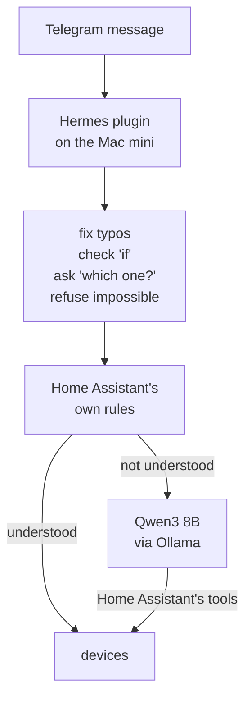

I wanted to message my apartment from my phone and have it work with no cloud model in the path: a Telegram bot, a small model running on the Mac mini, and Home Assistant doing the switching.

I'd rather my lights didn't depend on a cloud service, and I wanted to know how far an 8B model on a 16 GB Mac gets at this before it needs one. Passing unit tests say the pieces work. They say nothing about how often a real request goes wrong, and I wanted that count.

Hermes Agent owns the Telegram bot. A plugin Claude Code wrote hands each message to Home Assistant's Assist pipeline, which tries its own sentence rules first and passes whatever it doesn't understand to Qwen3 8B through Ollama, with Home Assistant's tools for finding and switching devices. The model is 4-bit with a 16K context, kept loaded: 6.6 GB of the Mac's 16. It reads about 200 tokens a second and writes about 18, and each message carries roughly 4,200 tokens of Home Assistant's instructions and tool definitions, so an answer takes 2 to 4 seconds with a warm cache and 25 to 35 with a cold one. The speed side is in [an earlier post](/posts/what-limits-local-ai-speed/). Seven Telegram shortcuts (`/lights_off`, `/home`, `/fan` and so on) skip the model and send one fixed request.

Everything below was measured on a bench: a second Home Assistant of the same version on the Mac, with about 290 fake devices copying my real ones' ids, names, aliases and areas. The real model runs against it and nothing in the house moves. I checked 190 phrases against the real Home Assistant, and the bench gave the same result on 189. Each test request has a right outcome, and Claude Code scores what happened to the devices and what the reply claimed.

What I found, in three parts:

1. The model was rarely the main problem. Most wrong moves and refusals came from Home Assistant's own rules, its exact-name matching, and the wiring between the two. Moving the bookkeeping into code (an "if" is checked by code, a vague request gets a question, typos are fixed before anything reads them) took 387 test requests from 7.8% wrong moves and 21.2% refusals to 2.1% and 11.6%.
2. Four other models, up to 14B, didn't beat Qwen3 8B on this Mac, and two of them filled its memory.
3. Among everything I measured, a phone typo cost the most: one slip took the share of refused requests from 9% to 32%.

## The names Home Assistant stopped answering to

The first version was Hermes with a small router in front of Qwen2.5 7B and a tool that sent sentences to Home Assistant. On October 12 it failed in a new way. "turn on the nightstand lamp" worked, then "turn it off" didn't: the router resolved "it" correctly, built the command from the device's friendly name, `turn off [Bedroom] Nightstand`, and Home Assistant answered that it wasn't aware of any device called that.

Read-only probing of the real Home Assistant showed it resolved some bracket-tagged names and refused others. Claude's first diagnosis fit a controlled test and was still wrong. Add one alias to a device and its name stops resolving, remove the alias and it resolves again, so the conclusion was that an entity with aliases is recognized by its aliases only. The data said otherwise. Home Assistant stores an entity's own name as a `null` entry in its alias list, and the alias script Claude had written dropped the nulls as junk and wrote back strings only. Seventeen of the 19 failing names were among the 20 entities it had touched. Home Assistant did what its data said, and the script had changed the data. It had also quietly changed my voice assistant.

The same day I corrected a misread that had cost a day. I'd written that Ollama didn't need to be open to my network, only that Telegram could reach it and Home Assistant could. Claude kept the first half and dropped the second, but Home Assistant calling the model is exactly what needs the LAN, and I had to say so again. Opening it put Home Assistant's own pipeline back in the design, which is the version of this problem that already exists: sentence rules first, a model second. Ollama has no password, so anything on my network can use it. I'm fine with that here.

The bot moved onto that pipeline on October 13. Claude Code's permission check had refused every live change, so I ran the cutover script myself.

## Why not just give it the keys

On October 17 I asked why the model couldn't run on the Mac with a Home Assistant MCP server and full access, and what Home Assistant's box was adding. It adds the only wiring to the devices, and an MCP server would be one more door into the same box. What's left to decide is how much of Home Assistant the model reaches and who does the bookkeeping. I told Claude to build it, and to make sure it could explain the trade-offs. It built three designs and wrote the adoption rule down before the first run, then added a fourth after the first results, with its own rule and 20 held-out requests written before it ran:

- **A**: Home Assistant's rules, then its model agent. This is the live one.
- **B**: the model with full-access tools, the MCP shape.
- **C**: Home Assistant's rules, then the model picks from a closed menu of valid actions, forced by Ollama's structured output.
- **A2**, the late one: Home Assistant's rules answer questions too, then the model.

I had also been reading a pass rate, and I asked for two numbers instead: "False rejection rate and a false accept rate." A false accept is something wrong reaching the house or me: a device that shouldn't change did, a request that should have been declined or questioned got acted on, or the reply claims something that didn't happen. A false reject is a fair request turned away: "couldn't find that device", an unneeded question, an error. False accepts are counted over all requests, false rejects over the ones that should have been done.

| Design | False accepts | False rejects |
|---|---|---|
| A, Home Assistant's rules then its model agent | 7.8% | 10.9% |
| A2, its rules answer questions too, then the model | 6.8% | 16.7% |
| B, full-access tools | 54.2% | 28.3% |
| C, closed menu | 14.1% | 6.5% |

That's 192 test requests on the bench, one run per design, same model. The false-reject column is the corrected one. My first scorer read 19.6, 21.7, 29.7 and 6.5, because its check that the model had looked at a device before answering only compared names, and the light and the switch behind it share one. It marked right answers as refusals for exactly the designs that answer through the model. Claude found it by rerunning the failures with the model's tool calls recorded and reading them. It's a bug a pass rate would have hidden, and it ran against the design I ended up using.

B is the answer to my question, and it was the worst. The 8B model skips listing devices and guesses ids (`light.donut`, `fan.vornado`, `media_player.sonos`), and Home Assistant answers a service call on an unknown entity with a 200 and an empty list, so the model reports success. Aliases live in the entity registry, not in the states API, so "donut" is invisible to it. Full access works for my Claude-based assistant because that one is Claude. C was best on refusals but took wrong actions: it acted on every match, picked `toggle` for "turn it off if it's on", and for something that doesn't exist it took the nearest device ("turn off the bedroom tv" paused the bedroom speaker). A2's idea was good, but sharing one conversation id put Home Assistant's own misses ("Sorry, I am not aware of any device called them both") into the model's history, and the 8B model repeated them.

## What the mistakes were made of

I asked that every decision be traced to a root cause I could follow, so Claude read Home Assistant's source (2026.7.4) and the recorded tool calls. None of these is the model being too small in the way a bigger one would fix.

| What went wrong | Root cause |
|---|---|
| "Color set" or "Brightness set" for a light that can't | Home Assistant's light rule never checks what the light supports, and the reply text is fixed. No model involved, and it turned the on/off plug on |
| Every question waited for the model | Assist skips its own question answering when an agent can control devices, because it would interfere with the model |
| "Could not find that device" | Lookups need the exact name, nickname or area, and fail if any detail is wrong. The model adds a guessed room or drops a bracket tag |
| A wrong move on "if the TV is off, turn on the pendant" | Read, decide, act is three steps with a negation, and a small model slips. For a curtain, Home Assistant's turn on means open and turn off means close |
| "Now open" for a curtain it had told to close | Home Assistant answers "success" for a command sent, not a device changed, and the model reports what it meant to do |
| Everything instead of one | The rules read "the lamp in the bedroom" as every light in the bedroom, and a light group lets one call hit many |

The model understands "could you kill the overhead light in the kitchen" fine. It's bad at exact names out of a long list, at checking before acting, and at reporting only what happened. The designs that won took those jobs out of its hands.

## Fixes, confirmed on requests written before the fixes existed

A design picked after seeing results has to be confirmed on requests that didn't suggest it. For the next fixes Claude wrote 47 new requests before any fix existed, and before the round after that, 91 more. A Sonnet sub-agent built each set of fixes without being shown them. Each fix sat behind a setting that stayed off, and the adoption rule (one rate lower with its paired interval below zero, the other no higher) was committed before the run.

| Design | False accepts | False rejects |
|---|---|---|
| A, as it ran that day | 10.0% | 13.2% |
| A plus a refusal of brightness or color a light can't do | 5.8% | 14.3% |
| Hybrid: Home Assistant's rules answer questions, its dry-run matcher deciding what it handles, plus the refusal | 5.8% | 11.6% |
| C with its habits fixed, plus the refusal | 3.9% | 7.9% |

That's 259 requests. The refusal declined 14 requests and all 14 were right: the "Color set" answers from the table above. All three passed the rule. The menu design had the lowest rates, but it only exists in the test harness, so the hybrid went live.

Then I asked for a second false-accept number. I know what each light can do, so I won't ask for a color the pendant doesn't have. I do make other mistakes: ambiguity, loose wording, typos. Claude labeled 40 of the 259 requests as ones I'd never send on purpose (a capability the device lacks, a device I don't have, a job the bot doesn't do), before computing anything. On the rest the hybrid's wrong-move rate was 6.4%, against 5.9% for the old setup and 4.1% for the menu. Its big gain had been the impossible requests. On requests I'd really send, the wins were the ones still ahead.

## Bigger models

I'd been here before. On October 12 the model that won my bake-off lost when put behind Home Assistant's tools: four of Qwen2.5 7B's five wrong answers were made up, while all of Qwen3 8B's failures said they had failed. That was nine questions, a smoke test, but it stuck: model quality belongs to the model and the interface together.

The registry wouldn't give Ollama 0.17.4 the new models (they need a newer version), so Claude installed 0.40.6 beside it with my OK, on its own port with its own model store, and compared everything against Qwen3 8B on that.

| Model | False accepts | False rejects | Memory | Typical answer |
|---|---|---|---|---|
| Qwen3 8B | 11.2% | 13.2% | 5.8 GB | 2.8 s |
| Qwen3.5 4B | 12.7% | 12.2% | 9.5 GB | 2.7 s |
| Gemma 4 12B | 12.0% | 5.3% | 16 GB | 3.6 s |
| Qwen3.5 9B, stopped at 81 requests | 14.8% (Qwen3 8B: 7.4% on the same) | 5.5% (9.6%) | 16 GB | 2.2 s |
| Qwen2.5 14B, older Ollama | 12.4% | 16.4% | 11 GB | 5.2 s |

Gemma 4 turns away far fewer requests, but it makes as many wrong moves and takes the whole Mac. The annoying part was memory. The newer models run on Ollama's MLX engine, which grows with every request until the model is unloaded: Qwen3.5 9B went from 7.7 GB to 16 GB in seven minutes, with 17 GB of swap, and I stopped it. Gemma 4 only finished because the test script unloaded it every 25 requests. The Qwen3 4B already on the disk is a thinking-only build whose reasoning lands in the reply, about 50 seconds a turn. On Home Assistant's own public benchmark the best cloud models score 6 to 9 points above Qwen3 8B ([home-assistant-datasets](https://github.com/allenporter/home-assistant-datasets)). I haven't run one on my bench.

## Phone typos

I'd be typing from my phone, so I asked for typos in the test set. Claude wrote 77 copies of realistic requests with one or two thumb slips each ("pendent", "teh fan", "entyway lights") and ran each design on the originals and the copies in the same session.

| Design | Refused, typed right | Refused, with a typo |
|---|---|---|
| A | 14.5% | 36.8% |
| Hybrid, live at the time | 9.2% | 31.6% |
| C | 3.9% | 47.4% |

The tool calls show the chain. Home Assistant's sentence rules need the words as written, so a typo sends the request to the model. The model then passes the typo through ("Pendent") or rebuilds a near-miss name ("Entryway Ceiling" for "[Entryway] Ceiling"), and Home Assistant's tools take exact names only. A few short follow-ups with a typo ("bavk on") got the no-guessing line with no lookup at all. The menu design got worse than the rest, because the guard I'd added against acting on a device the request doesn't name read a misspelled word as a device I don't have.

## Three fixes, and what they bought

Claude wrote three fixes, each behind its own setting: typo correction against the home's own words before anything reads the message, an "if" check that reads the device's state and runs only the action (or says why not), and a "which one?" question when a singular request fits several devices. The typo fixer only makes edits a thumb makes: a neighbouring key, a dropped, doubled or swapped letter, words run together. It restores 66 of the 77 typo'd texts exactly. It leaves "of" for "off" alone, since "of" is a word. It changed one of 315 clean test texts ("livingroom" to "living room") and none of the 74 real messages I'd sent the bot.

I picked all three over the typo fix alone, which was the only one that cleared the pre-written rule by itself. The other two each fixed most of their own mistakes but covered too few requests to clear it alone.

| Added to the live hybrid | False accepts | False rejects |
|---|---|---|
| nothing | 7.8% | 21.2% |
| typo correction | 7.2% | 12.8% |
| "if" check | 5.2% | 21.5% |
| "which one?" | 6.2% | 20.1% |
| all three | 2.1% | 11.6% |

That's 387 requests, 91 of them written before the fixes existed. By slice, from the hybrid to all three:

| Requests | False accepts | False rejects |
|---|---|---|
| 219 realistic, typed right | 5.9% to 1.8% | 13.2% to 11.1% |
| 140 with typos | 7.1% to 2.1% | 32.6% to 12.6% |
| 17 new "if" requests | 11.8% to 0% | 22.2% to 0% |
| 11 new one-versus-several | 45.5% to 9.1% | 18.2% to 18.2% |

I told Claude to switch the bot to all three, and it did, just after midnight on October 20. The sample sizes in the last two rows are small. Run to run, design A agreed with itself on 205 of 212 shared requests, so differences of a point or two are noise.

## Update, October 26: a week of real use

I sent the bot 15 messages in the week after the switch. Eleven were shortcut buttons, three were answered by Home Assistant's own rules in under a second ("Tv off", "turn on the TV", "Turn off all the lights"), and one went to the model. No errors, and the three new fixes never fired, because nothing I sent needed them. The model is the part I touch least.

The one that went to the model was "Are you sure they're all off", after the bot said it had turned everything off. It took 65 seconds and was right: the donut lamp was on. The logbook shows the lamp going off at 23:48:34 and back on six seconds later, then again at 23:49:05 and 23:49:11. The context on each "on" is my sunset automation, not the bot. That automation starts a script that fades the lamp between two ambers, 500 repeats of two turn-on calls ten seconds apart, almost three hours, restarted at the top of every hour from sunset. Its 11 pm step turns the lamp off once and doesn't stop the loop, so while the 10 pm run is going the lamp is back on within ten seconds (off at 23:00:00, on at 23:00:09). My Midnight automation does stop it, with `script.turn_off`. The bot did what I asked and told the truth about it, and the house undid it.

Two smaller things from the same review. The 65 seconds was mostly a cold prompt cache, though that night was slower than the cold answers measured since (27 to 35 seconds), and I can't explain the difference. Claude captured what the bench's Home Assistant sends the model, and the prompt and its 27 tools are byte-identical between conversations (4,236 tokens), so the text isn't what changes. A first question on the real Home Assistant took 35 seconds after days idle, 27 seconds right after Claude wrote an unrelated prompt over the cache on purpose, and 2.7 seconds warm. Why the cache is gone after a long idle isn't pinned down. And for questions about the donut specifically, the model often returns an empty message (after 37 tokens in the one captured), which Home Assistant reports as "Unable to get response". I suspect the emoji in the lamp's name. I haven't tested that.

## What's left, as of October 26

- Stop the sunset loop at 11 pm the way the Midnight automation does.
- Find out why the cache goes cold after a long idle: ask twice, ten minutes apart, and see.
- Rename the donut without the emoji and see whether the empty replies stop.
- Run a cloud model on the same bench for a ceiling number.
- "of" for "off" and the plural "dim the lights", which acts on all of them where the test expects a question.
- Give the menu design a Telegram path, after it stops disabling three automations for "turn off all the automations" without asking.

---

*[How this was built](/how-i-work/): Claude Code wrote the plugin, the bench, the test sets and the scoring, ran every experiment, and handed the bench and two sets of fixes to Sonnet sub-agents. I set the goal and the constraints, caught Claude misreading one, asked the questions that shaped the tests (why not full access, two error rates, leave out what I'd never ask, add phone typos), picked which fixes went live, ran the first cutover myself, and used the bot for a week. Tested: the real model on the Mac mini behind every number, and the live bot on my real Home Assistant for a week (15 messages). Not tested: the designs on real devices (the bench's are fakes with no delays or failures), more than one run per design, typos I actually make (the 140 typo'd requests were written by Claude to look like phone slips), any cloud model, and the menu design on Telegram.*
