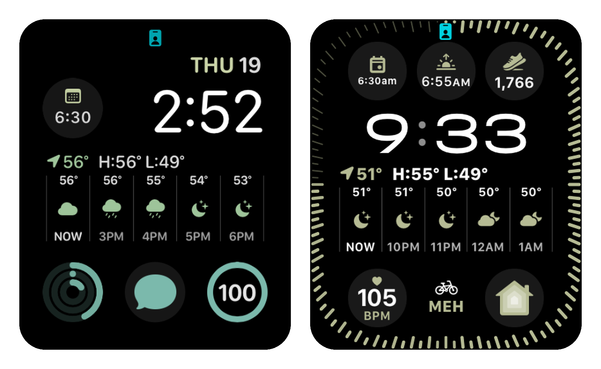
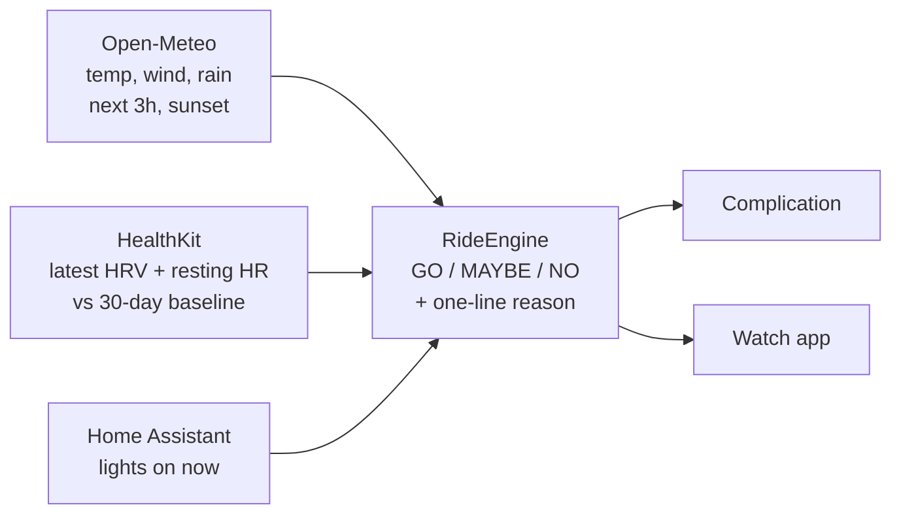

I upgraded from an Ultra 2 to an Ultra 4, and for the first week it felt like the same watch with a nicer screen. Same face I'd worn for two years, same glance at the time and nothing else. So: what does the Ultra 4 actually do that the Ultra 2 couldn't, and how do I get that onto my wrist without spending an evening in the Watch app?

The second half has an easy answer. I handed the setup to Claude. It ran from my Mac mini with Home Assistant open in a browser, my iPhone through iPhone Mirroring, Xcode, and a cable to the watch. I said what I wanted, judged what came back, and did the few things it physically couldn't.

## What's new since my Ultra 2

From [Apple's announcement](https://www.apple.com/ie/newsroom/2026/09/apple-unveils-apple-watch-ultra-4/) and [the5krunner's spec breakdown](https://the5krunner.com/specs/apple/watch-ultra-4/), the parts that matter to me:

| Ultra 4 | What I do with it |
| --- | --- |
| Heart rate every 5 seconds, all day, with a real-time heart rate complication | Live heart rate on the main face |
| HRV measured up to 24 times more often, plus Recovery HRV and a daily Readiness score | Readiness on the Sleep face; HRV feeds my ride call |
| 50 h battery, 18 h from a 15-minute charge | Wear it overnight every night, which the HRV baseline needs |
| Max Extended Workout: up to 45 h with GPS every second | Long rides at full GPS (future work) |
| Satellite SOS, Messages and Find My, 5G | New to me since the Ultra 2 (future work) |
| Redesigned pedometer and a Steps complication | On the main face |

The heart sensing is the headline. A new optical sensor with double photodiodes and bigger, more efficient LEDs reads heart rate every five seconds, all day. That's what the rest of this is built around.

## Live heart rate on the face

The first ask: one face that works, so I can stop thinking about it. Claude landed on **Modular Ultra**, the densest of Apple's faces and the one that uses the Ultra's whole screen. The slots went to things I actually glance at: my next calendar event, sunset, steps, the hourly forecast, the Ultra 4's live heart rate in place of the activity rings, my ride call and a Home button.

*Before and after, both screenshotted off the watch. Right: live heart rate (105 bpm, refreshed every 5 seconds) where the activity rings were, next to RideCall's MEH.*

The Sleep face uses the Ultra 4 too. I asked for the red Night Mode version, and the first attempt kept the default complications, compass included. Nobody's orienteering at 2am. The second pass treated it as a bedside clock:

| Slot | Complication | What it answers |
| --- | --- | --- |
| Top left | Alarms | When is my next alarm? |
| Top middle | Heart Rate | Live, every 5 s |
| Top right | Battery | Will it make it to morning? |
| Bottom left | Daily Steps | Had the room |
| Bottom middle | Sunrise/Sunset | Is it light out yet? |
| Bottom right | Home | Lights off without getting up |
| Bezel | Readiness | New on the Ultra 4: how's today going to feel? |

*The red Night Mode face for Sleep.*

## RideCall: weather and recovery

Off-the-shelf covered the faces. The one question nothing answered is the one I ask every morning: **should I ride today?** Weather apps give me eight numbers and leave the same math to me every day, and none of them know how I slept.

I already had the weather half. My Home Assistant automation "Cycling Weather - Green Light" turns a light green when conditions are good. RideCall puts those thresholds on my wrist, and the Ultra 4 adds the other half: whether my body is up for it.

| Verdict | Conditions |
| --- | --- |
| GO | 55 to 78°F, wind under 15 mph, dry, and recovered |
| MAYBE | Weather says GO but HRV is under 80% of my 30-day baseline, or resting heart rate is 5+ bpm over it. Also: chilly, breezy, warm or dark |
| NO | Wet, wind 20+ mph, under 45°F or over 88°F, or 50%+ rain chance in the next 3 hours |

Readiness itself isn't something apps can read. Claude checked the watchOS 27 SDK headers: HealthKit exposes resting heart rate, SDNN HRV and a new RMSSD HRV type, which looks like the data behind Recovery HRV, but no Readiness score. So RideCall builds its own, smaller version: the latest RMSSD reading (falling back to SDNN) against the median of the last 30 days, plus resting heart rate against its own baseline. Weather can only ever be downgraded by the body check, never upgraded.

*RideCall the first night it ran. It was 50° and chilly, which was already a MAYBE, and the body check stacked a second reason on it: my latest HRV was 59% of my 30-day baseline. On the face the same verdict reads GO, MEH or NO.*

The first reading surprised me. HRV was well under baseline while resting heart rate was 11 bpm below its own, so the two signals disagreed. RideCall only needs one of them to call me not recovered, which is the conservative choice. Whether that's the right call is what the next few weeks of ignored MAYBEs will tell me.

Claude wrote all of it: a watchOS app plus a WidgetKit complication, generated from one XcodeGen spec, with weather from Open-Meteo straight from the watch and a best-effort lights count from Home Assistant over LAN or Tailscale.

Getting it onto the watch took one surprise. On watchOS 27 the watch starts the pairing, not the Mac: Settings > Privacy & Security > Developer Mode on the watch, then a code to type on the Mac. And Xcode only found it while it sat on its charger next to the Mac. On the wrist it drops Wi-Fi to save battery.

A free Apple developer account is enough to sideload, but the signing expires every 7 days. RideCall on its own isn't worth $99 a year; the paid account only pays off if it covers a handful of apps I'd actually build. Until then a launchd job on the Mac mini checks the signing twice a day and rebuilds and reinstalls when it's within 3 days of expiring. Renewing the signing itself still needs me: Xcode 27's command-line tools can't see my Apple account, so once a week the job pings me to press Run in Xcode. The list is already at two: my guitar tuner app, pluck, rides along on the same job.

## The groundwork

None of this sticks if the face keeps changing on its own, which mine did. A day after the new face went on, the old Ultra 2 face came back. Two features were working together:

1. **Each Focus mode had its own watch face linked.** Turning a Focus on swaps the face. I'd set these up years ago and forgotten.
2. **Smart Activation was on for Work and Personal.** iOS guesses when I'm "working" from location and app usage and turns the Focus on. It was guessing wrong.

*Work Focus with its linked face at the bottom right. Smart Activation, further down this page, was what kept turning it on.*

Claude turned Smart Activation off, gave Work a real schedule (9 to 6 on weekdays) and pointed every Focus at the new face, Sleep at the red one.

The Home button on the face needed Apple Home, and my house runs on Home Assistant. HA's **HomeKit Bridge** shares selected entities with Apple Home, and the watch treats them like any HomeKit accessory. Claude bridged 19 on purpose, not everything: 13 lights plus an All Lights group, the kitchen floor lamp, the Vornado fan, and four scripts and scenes. It needed the living room Apple TV as a home hub, and Apple Home wanted every accessory in a room, so Claude sorted them over iPhone Mirroring.

*Apple Home after Claude sorted the bridged entities into rooms. Every tile is a Home Assistant entity.*

The same bridge fixed the iPhone's Action Button. The Home Assistant app's own control flashed ON / OFF in the Dynamic Island and did nothing. Claude pulled HA's logbook for the moment of the press and it was empty: the request never left the phone. The Action Button now runs Apple Home's All Lights, and the logbook shows each press arriving tagged `context_domain: homekit`.

*The Action Button on Apple Home's All Lights.*

## Where the AI stopped

Claude did most of this, not all of it. What I still did by hand:

| What | Why |
| --- | --- |
| Setting the active watch face | The agent's safety layer blocked it, even after I said yes |
| Deleting old watch faces | Same |
| Logging into Home Assistant, Xcode and other accounts | It won't type passwords |
| Pasting the HA token | It won't enter secrets into fields |
| Approving RideCall's Health access on the watch | Health permissions are mine to grant |
| Turning on Developer Mode and entering the pairing code | Apple requires it on the device |
| Unlocking the phone and the Mac | Face ID and passwords are mine |

My first reaction was annoyance: I typed "i give you permission" and it still wouldn't set the face. Thinking about it more, I'd rather an agent that drives my phone hold a few lines no matter how the request is worded.

Other quirks: iPhone Mirroring drops every time I pick up the phone and wants a re-auth after; fast typing dropped characters, so Claude typed one key at a time; and it sees whatever's on screen, Messages notifications included, which it left alone.

## Future work

- Take Max Extended Workout on a long ride and see whether 45 h at 1 s GPS holds up.
- Try satellite Messages somewhere with no signal.
- Put the same ride verdict on the TRMNL by the door.
- Tune the recovery thresholds after a few weeks of seeing which MAYBEs I ignored.

---

*[How this was built](/how-i-work/): Claude set up the watch faces, Focus modes, HomeKit Bridge and Apple Home rooms over iPhone Mirroring and Home Assistant's API, debugged the Action Button from HA's logbook, checked the watchOS 27 HealthKit SDK, and wrote RideCall (a watchOS app and WidgetKit complication with a HealthKit recovery check) and the auto-reinstall job. I decided what the Ultra 4 should be used for, picked every slot and the 19 bridged entities, set the weather thresholds from my existing cycling automation and the recovery thresholds, called out what was wrong (the compass on the Sleep face, the lost sunset time, losing live heart rate), and did the sign-ins, token, Health permission, Developer Mode and pairing by hand. Tested: the faces, Focus fix, bridge and Action Button on the real watch and phone; RideCall on the watch against the day's weather, my HRV and resting heart rate, and HA's light count. Not tested: the auto-reinstall's renew path (first run around Nov 23), Max Extended Workout and satellite.*
