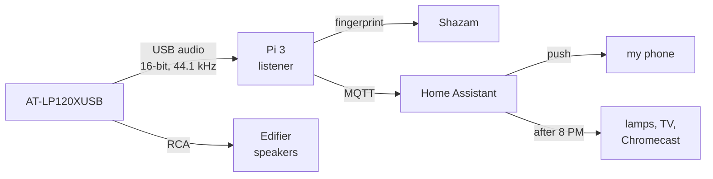
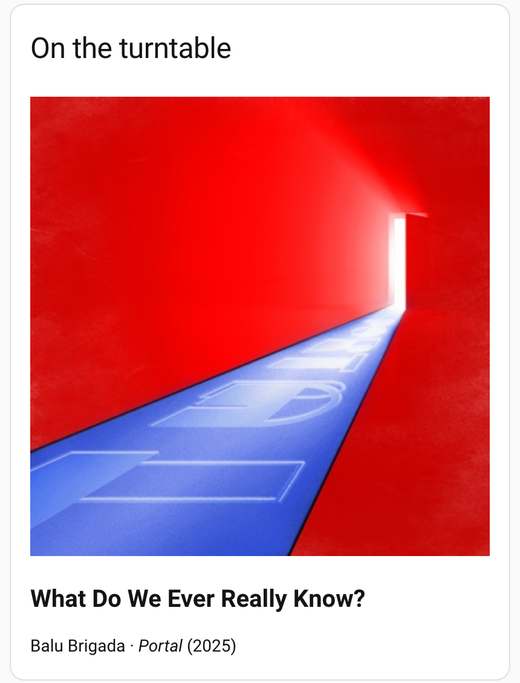
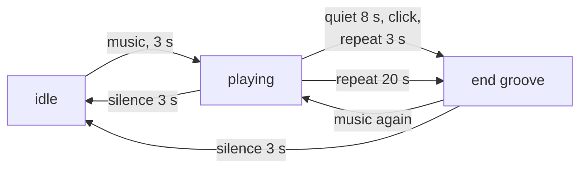

This started with a monitor I was selling.

I wanted three things from my record player: the room to settle down when I put a record on at night, an honest count of hours on the stylus, and a nudge when a side ends so the needle isn't riding the end groove while I'm in the kitchen. I didn't want another box for it. The turntable already has a USB output, and I had a Pi with nothing to do.

The Pi was the one that used to run my Home Assistant, already in a nice case. For the sale I had Claude make it boot straight into a page that reads the monitor's EDID (model, size, native resolution) and cycles through solid colors and gradients, so a buyer could see the panel working without me setting up a computer. Once the monitor was gone, I went looking for a better job for the Pi than a drawer. Plenty of people already feed a turntable into Home Assistant for a now-playing display (the [Vinyl Listener](https://community.home-assistant.io/t/app-vinyl-listener/1013370) app does it with Shazam), and I'd bought my turntable last year partly because of the USB port, without a plan for it. That settled it.

Reflashing the card was the first snag. The Mac stopped seeing it, in more than one reader, and Claude was ready to call the card dead. It had booted an hour earlier, so we kept digging, and the system log had the answer: macOS ejects removable media inserted while the screen is locked. I unlocked the Mac and it flashed fine.

## What the deck gives you over USB

The AT-LP120XUSB has a built-in preamp and a USB port next to the RCA jacks. On the Pi it shows up as a plain USB sound card (`USB AUDIO CODEC`, a TI PCM2900C): 16-bit stereo at 44.1 kHz. That's all you get. No speed, no tonearm position, no start or stop signal, and nothing to send back either, because the deck is fully manual. The chip also advertises a playback side and a button interface, but as far as I can tell nothing on the turntable is wired to them.

So everything here comes from listening. Claude wrote the listener: one Python file on the Pi, about 700 lines, that reads the audio with `arecord`, works out the state every half second and publishes it to Home Assistant over MQTT. It uses [MQTT discovery](https://www.home-assistant.io/integrations/mqtt/), so the entities show up on their own as a "Turntable" device.



What it does now:

1. Tracks the state: idle, playing, or the stylus in the end groove. It also logs session length and platter speed, and counts stylus hours against the 300 the manual gives the stock stylus, with a reset button for when I replace it. Warnings come at 240 and 300 hours.
2. Names each song, shows it on a now-playing card with the cover art, and keeps a log of every song played.
3. Pushes "Side's over. Lift the arm." to my phone when a side ends, then reminds me at 5, 15 and 30 minutes if the stylus is still in the groove.
4. After 8 PM, a record starting pauses the Chromecast Audio, turns off the TV, pauses the motion-triggered lights and dims a lamp to warm. The motion lights come back 15 minutes after the record stops.



That card is showing a song it named from Sunday night's recording.

## A quiet song or the end of the side?

Loudness gets you most of the way. Here's what the deck reads at the Pi, as RMS over half a second, from a full play of both sides:

| On the stylus | Loudness, dBFS |
|---|---|
| Music | mostly -18 to -35 |
| Quiet passages and gaps between songs | as low as -56 |
| The end groove | -37 to -58 |
| Arm up | -85 to -94 |

Music against arm up is easy. A quiet passage against the end groove isn't: they overlap. The end groove does have two tells. It usually clicks once per revolution, every 1.8 seconds at 33⅓, and the audio repeats almost exactly, because the stylus keeps going around the same circle.

Claude's first version listened for the clicks: autocorrelate the loudness envelope and look for a peak at 1.8 seconds. It found them in a recording of the first record's end. Then I went to bed with a different record on. That one ended in a locked groove with music in it, a short loop that just keeps playing, so the listener counted it as music until I stopped it the next morning, 6.5 hours later. Those hours are on the stylus counter, and they're real wear.

So Claude added a second test: compare each revolution of audio with the one before it.

```python
# The last revolution of audio against the one before it, at 4,410 samples/s.
# The lag search covers ±1% of platter speed error, one sample at a time.
n = int(period * REPEAT_RATE)              # 1.8 s at 33 1/3 rpm
last = buf[-n:] - buf[-n:].mean()
for lag in range(-slack, slack + 1):
    prev = buf[-2 * n - lag:-n - lag]
    prev = prev - prev.mean()
    corr = np.dot(last, prev) / np.sqrt(np.dot(last, last) * np.dot(prev, prev))
```

The first version of the lag search stepped a few samples at a time and never matched: on a synthetic loop the best it found was 0.45. A two-sample miss is enough to hide the match. One sample at a time got the same loop to 1.00. The lag that wins also gives the platter speed to a sample, which is how Home Assistant knows the deck runs at 33.33 rpm.

## The test that found the real bug

On Monday morning I played Novo Amor's Collapse List, both sides, to test the whole chain on one record. Side A worked: every song named, the push about 10 seconds after the music stopped, the 5-minute reminder on time.

Side B sent me two "Side's over" pushes in the middle of the side, both during quiet stretches between songs. The click test was firing on music. My guess is a soft beat near 1.3 or 1.8 seconds looks like a click train to an autocorrelation with 0.1-second resolution. It had also read the platter at 46 rpm, for the same reason.

What I told Claude: I'm fine with it showing nothing in a gap between songs. It shouldn't tell me the side is over, and be that confident about it, when it isn't true.

So the clicks alone no longer end a side. The audio also has to repeat once per revolution for 3 seconds, and the platter speed now comes only from the repeat test. The rules now:



Claude checked the change against Sunday's recordings on the Pi before installing it:

| Recording | Old rule | New rule |
|---|---|---|
| Music with 25 s turned down 26 dB, as a fake quiet stretch | "Side over" at 31 s, back to playing at 48 s | Playing throughout |
| The real end of Sunday's first record | End groove at 114 s | End groove at 114 s |

Then I played both sides again and let each one run into the end groove. Here's what Home Assistant logged for both runs:


| | Old rule (morning) | New rule (afternoon) |
|---|---|---|
| False "Side's over" pushes | 2 | 0 |
| Songs named right | 10 of 11, one wrong for 100 s | 11 of 11 |
| Push after the music stopped | about 10 s | about 20 s, and 40 s on side A, which has a long lead-out |


Top: loudness, with the dashed line at -36 dBFS, where music starts. Bottom: the repeat score, with the dashed line at 0.6. The two drops at 11:46 and 12:18 are the flip and the arm lift. In the two end-groove spans the repeat score had a median of 0.89, with 94% of samples at 0.6 or more. Songs had a median of 0.13, with 5% at 0.6 or more. Those 5% are the part I don't love: a few quiet moments hit 0.63 to 0.87 for a sample. Eight seconds of quiet, the clicks and a 3-second hold together kept them out on this record. A quieter record might find the gap, and if it does, the hold gets longer. I also don't know why side A's groove got noisier after a few minutes. My guess is the stylus stirring up dust, lap after lap.

## Naming the songs

The names come from Shazam, through [ShazamIO](https://github.com/shazamio/ShazamIO), an unofficial Python client. Its Rust core computes the fingerprint on the Pi, and only the fingerprint goes to Shazam, never the audio. A lookup takes about a second on the Pi 3. The listener asks 12 seconds after a record starts, 12 seconds after each gap between songs, and every 2 minutes otherwise for albums that run songs together, so a new song shows up about 15 seconds in.

Shazam also reports how far the pitch is off the original recording, which on a turntable is the platter's speed error. Across 23 matches on this deck it read -0.07% to +0.10%. That turned out to be useful beyond trivia. On Monday morning, side B's first song came back as "Water Tower Town" by Scotty McCreery, on a Novo Amor record, and that match read +0.5%: five times further off than any real one. So now a match more than 0.25% off gets a second lookup 8 seconds later before it's shown. The afternoon run caught one: a lookup during "Sand & Sky" came back as a song from the soundtrack of the film Jersey, it never showed, and the second look said "Sand & Sky" again.

The play log is one line of JSON per song on the Pi, and Home Assistant's logbook shows the same list under the card.

## Two smaller fixes

The first "Side's over" push never arrived. Every Home Assistant push to my phone had been failing silently for five days: the notify script still called the service for my old phone, which went away when I switched. One Home Assistant script fix brought them all back.

`arecord`'s default buffer is half a second, and a single hiccup on the Pi 3 dropped about a second of audio right as a side ended. The buffer is now 2 seconds, which is as much as the USB driver would give.

## Future work

- **IR.** The Edifier R1280T speakers only take volume and mute from their remote, but that's enough for the wind-down to turn them down too. IR LEDs arrive Tuesday for the Pi. The kitchen fan is next, and the Pi can't see it past the kitchen table, so that emitter goes on the ESP32 gateway in the kitchen that already runs my Vornado fan and weather sensors on [OpenMQTTGateway](https://docs.openmqttgateway.com/). The plan is one file of IR codes and any number of emitters, with Home Assistant seeing devices, not emitters.
- **Voice.** The Pi has a USB mic plugged in, but it's too weak for a voice assistant across the room. Local voice will probably live on the Pi 5.
- **Stopping the platter.** The power switch latches and Start is a momentary button, so a smart plug could stop the platter when I forget about it. An energy-monitoring plug could also tell when it's spinning with the arm up, which is silent on the USB audio.
- **45s.** Everything here was tested at 33⅓. The repeat test knows 45 rpm, but I haven't played a single yet.

---

*[How this was built](/how-i-work/): Claude Code wrote the listener, the Home Assistant entities, automations and dashboard card, and the monitor test page, analyzed the recordings and Home Assistant's history, and did the installs over SSH. I picked the project and what it had to do (a wind-down for records at night, stylus hours, knowing what's playing; not concert alerts or audio in other rooms), set up the Pi and the cabling, played the records, designed the end-to-end test, and called out what was wrong on the real deck, including the "Side's over" push during a quiet song that became the rule: never say a side is over unless it's sure. Tested: both sides of Collapse List on the deck, twice (before and after the fix), replays of Sunday's recordings on the Pi, and the wind-down on Sunday night. Not tested: 45 rpm records, a record Shazam doesn't know, and IR (no LEDs yet).*
