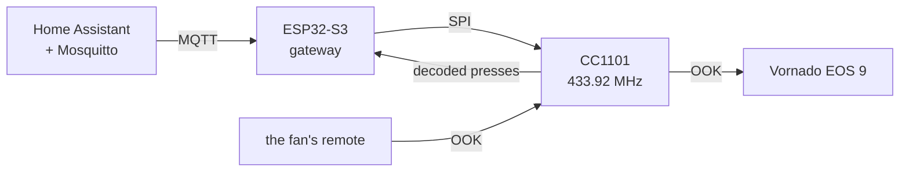

I'm on a mission to automate my life, and I over-engineer it along the way.
Lately I've also been Claude maxxing, which is why there are so many posts.

The [first post](/posts/vornado-eos-9-rf-remote-reverse-engineering/) ended
with the fan's remote decoded and a plan to put the fan on
[Home Assistant](https://www.home-assistant.io/). The fan has a perfectly good
remote, so none of this needs to exist. I wanted it anyway.

I used to leave the fan running all day. What I wanted was every button in Home
Assistant, a few automations so it runs only when it should, and one cable for
data and power.

## The Flipper first

The [Flipper Zero](https://flipper.net/) already has a sub-GHz radio, so before
building anything I made it the fan's remote. The question was whether the
decode was enough on its own: could it make every button press from the 32-bit
word, with no captured files? I asked for the app on the bike ride home, with
speed on Up and Down and oscillation on Left and Right. Claude Code planned the
rest, and at my call a cheaper model wrote it. Its frames matched the file that
turned the fan on in the first post, value for value, and the fan obeyed.


Everything I tried did what the map said except oscillation. The first post
named 0x040 and 0x080 as the 90 and 180 degree buttons. 0x040 lights an
indicator with up and down arrows and toggles it, and 0x080 goes to 90, then
flips between 90 and 180. So it's one control for turning oscillation on and
off and one for the range.
[Vornado's Quick-Start Guide](https://vornado.com/cdn/shop/files/EOS9_Quick-StartGuide.pdf)
lists a vertical oscillation control, which is my guess for the first.

The Flipper also showed the catch: the fan never answers and most of its codes
are toggles, so whatever controls it has to keep a guess of its state.

## The hardware

It's a [Waveshare ESP32-S3-ETH](https://www.waveshare.com/esp32-s3-eth.htm)
(the PoE module came with it) and a generic 433 MHz radio module built on TI's
[CC1101](https://www.ti.com/product/CC1101) chip, running
[OpenMQTTGateway](https://docs.openmqttgateway.com/) built from source. Home
Assistant got the
[Mosquitto broker](https://github.com/home-assistant/addons/blob/master/mosquitto/DOCS.md)
for this. I planned to power it from my
[eero PoE Gateway](https://eero.com/shop/eero-poe-gateway), so one cable under
the desk would carry data and power.



The PoE module has to stay on the board and covers some of the header pins, so
the radio got the six it doesn't. Claude Code matched the wire colors to the
resistor color code, so a wire's color is its CC1101 pin number. The SPI is on
IO0, IO1, IO2 and IO43, and the data line is on IO44. The first wiring was
press-fit jumpers, a known risk I took to get it online before I left the
house. It's soldered now, and a printed case is next.

Ethernet came up at 100 Mbps on the first boot, with Wi-Fi configured as the
fallback. That got a real test when I moved the gateway to a room with no cable
and it came back on Wi-Fi by itself. Updates go over the network now. The PoE
module isn't back on yet, so PoE power is untested.

## Sending without the data line

OpenMQTTGateway sends by bit-banging the radio's data pin. My press-fit data
wire wasn't making contact, so Claude Code had the CC1101 clock the frame out
of its own FIFO instead, and that stayed. At 2.51 kBaud one symbol is one 398
us tick, so a frame is just bits: a data 1 is `1110`, a 0 is `1000`, and a
press is eight frames. Home Assistant sends it like any OpenMQTTGateway code,
with a protocol number I picked:

```
home/OMG_VORNADO/commands/MQTTto433   {"value": 56545282, "protocol": 99}
```

The Flipper made a good witness. Its stock `subghz rx_raw` caught the gateway's
frames, and measured the same way as the real remote's they came out close:
short mark 406 us against 397, sync gap 11.94 ms against 11.96. Then at home,
Power turned the fan on, and again off.

The Flipper did most of the testing, in both directions, because it had already
proven it could talk to the fan. A script had the gateway send and the Flipper
capture it, then had the Flipper transmit and checked what the gateway
published. That all ran from the Mac, with the no-action codes (0x400 and
0x800) for anything that could move the fan, so I didn't have to be at the fan.

## Dropping off every few minutes

The first run of all ten commands did nothing. Mosquitto's log had the pattern:
the gateway connected, 90 seconds later the broker dropped it for "exceeded
timeout", and a few minutes later it connected again. Sixteen of seventeen
sessions ended that way. Wi-Fi was the obvious suspect, at -73 dBm.

It wasn't Wi-Fi. For two hours a script held the board's USB port open to catch
a crash, and nothing dropped. Four minutes after it let go, the timeouts came
back.

The board logs over the ESP32-S3's built-in USB serial, and with the Mac
attached and nothing reading the port, each write waits for room.
OpenMQTTGateway logs on every message, so the main loop stopped getting back to
MQTT in time. One line after `Serial.begin()` fixed it:

```cpp
Serial.setTxTimeoutMs(0); // unread log output is dropped instead of waited on
```

The fixed build has stayed up since, apart from test builds and me unplugging
it to move it. On a wall charger it couldn't have happened anyway, with no USB
host to wait on.

## Home Assistant

Each button is an MQTT-discovery entity under one device, named as in the
Quick-Start Guide. Fan Speeds and Airflow Modes are inferences: I captured
those two as `Blade` and `Menu`.


The fan reports nothing, and Power is a toggle, so "turn the fan off" can only
mean "press Power if it's on." Home Assistant keeps a guess in a "Fan is on
(assumed)" helper that flips whenever a Power command goes out, or the gateway
hears the real remote's Power. Four automations check it before they press
anything:

- **On at bedtime:** 10 PM if I'm home, and again if I get home later that
  night. I've been trying to go to bed earlier, so the fan starting is the cue.
- **Off in the morning:** 7 AM. The first time it ran, Power went out at 7:00,
  and I woke up after 7 to a fan that was off.
- **Off when I leave:** ten minutes after I do, so a GPS blip doesn't count.
  Three departures in one day: twice the guess said on and Power went out
  exactly ten minutes later, once it said off and nothing did. The fan was off
  when I got home.
- **On when the apartment is hot:** the living room sensor, an
  [IKEA Timmerflotte](https://www.ikea.com/us/en/p/timmerflotte-temperature-humidity-sensor-smart-50618957/),
  above 77 °F for five minutes while I'm home. I said hot is somewhere between
  75 and 79, so it's a slider. It hasn't fired; the apartment has stayed
  between 65 and 68 °F.

The 10 PM rule didn't fire that night, because my phone had died while I was
out and Home Assistant never learned I was home. When I powered it back on,
Home Assistant saw me home, the arrival rule pressed Power in that same second,
and the gateway acknowledged it a second later. A dead phone is invisible to
GPS and to its own Wi-Fi, so "home" got broader.
[A community eero integration](https://github.com/schmittx/home-assistant-eero),
installed through [HACS](https://hacs.xyz/), sees the phone the moment it joins
the Wi-Fi, and I added that tracker to my Home Assistant person. My Apple Watch
is a second tracker, a fallback for a dead phone. The cost is on the way out:
eero keeps a device home for five minutes after it disconnects, so the leave
rule can fire a few minutes late.

So the bedroom routine has now run end to end: on when I got home, off at 7:00,
no remote involved.

## One receiver for the remote and the sensors

The guess goes stale the moment someone uses the real remote, so the gateway
has to hear it. The receiver was already running
[rtl_433](https://github.com/merbanan/rtl_433) (the ESP32 port is
[rtl_433_ESP](https://github.com/NorthernMan54/rtl_433_ESP)) for my neighbors'
weather sensors, which is the next post. OpenMQTTGateway runs one decoder
library at a time, so Claude Code said it was the remote or the sensors.

I didn't buy that, and I was right. Both are 433.92 MHz on-off keying, so one
radio hears both, and the limit was software. rtl_433 has no decoder for the
fan, so Claude Code wrote one and registered it at startup, leaving the library
untouched. A press arrives as one `Vornado-Remote` message, and an automation
flips the guess when it's Power.

Next to the gateway I pressed Power four times, and each press flipped the
guess within the same second, at -55 to -72 dBm. From my bedroom the presses
didn't register: the gateway sits at the kitchen's west window, a spot I picked
for the weather sensor. I'm fine with that. The point of all this is to stop
using the remote, and the gateway only has to reach the fan to transmit. The
gap is that a press from out of its range goes unnoticed and the guess goes
stale. That's the one I'm living with.

## What's left

- A printed case, then the PoE module back on so it runs from one cable.
- A bedroom motion sensor, so the fan follows whether I'm there and the clock
  stops standing in for it.
- The weather sensors: the same receiver hears two of my neighbors' sensors, a
  different one from each kitchen window. That's the next post, after a week of
  comparing one against the forecast.
- An IR blaster for the Rowenta fan in the kitchen, maybe on
  [ESPHome](https://esphome.io/), which I've wanted to try.

---

*[How this was built](/how-i-work/): Claude Code wrote the firmware changes,
the Home Assistant setup and the test scripts, and had a cheaper model write
the Flipper app. I picked the hardware, wired and soldered it, decided what the
automations do, and ran all of it against the real fan. Tested: on the real
fan, everything above except the list below. Not tested: the 10 PM trigger, the
hot rule, the leave rule since eero joined my presence, the watch as a
fallback, PoE power, and what Fan Speeds, Airflow Modes and Light Settings do.*
