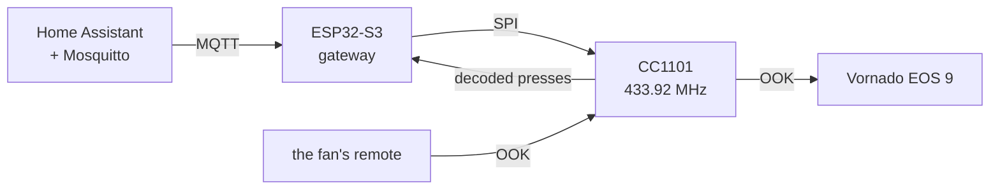

The [first post](/posts/vornado-eos-9-rf-remote-reverse-engineering/) ended
with a plan: a CC1101 and an ESP32 that put the fan on Home Assistant. The
[Flipper post](/posts/vornado-remote-on-the-flipper-zero/) showed the decode is
enough to build every frame from scratch. This one is the box.

What I wanted from it: every button of the remote in Home Assistant,
automations that use them, and one cable under the desk for data and power.
The board has an Ethernet jack and takes a PoE module, which is what that last
part needs.



## The box

The board is a Waveshare ESP32-S3-ETH (the PoE version: ESP32-S3R8, 16 MB
flash, 8 MB PSRAM, a W5500 for Ethernet). The radio is a generic 8-pin 433 MHz
CC1101 module. The firmware is OpenMQTTGateway, built from source with
PlatformIO, and Home Assistant gets the Mosquitto add-on, which I installed
for this.

The pins came from one constraint: the PoE module had to stay on, so the radio
could only use header pins it doesn't cover, from IO2 to the antenna corner.
GPIO 4 to 14 aren't on the headers at all (the TF slot and the W5500 use them).
That left exactly six pins, five signals and a ground, plus 3V3 from under the
module.
Claude Code matched the wires to the resistor colour code, so a wire's colour
is its CC1101 pin number:

| CC1101 pin | Signal | Wire | ESP32-S3-ETH |
|---|---|---|---|
| 1 | GND | brown | GND |
| 2 | VCC | red | 3V3 |
| 3 | GDO0 (data) | orange | IO44 |
| 4 | CSN | yellow | IO0 |
| 5 | SCK | green | IO1 |
| 6 | MOSI | blue | IO2 |
| 7 | MISO | violet | IO43 |
| 8 | GDO2 | none | |

The first wiring was press-fit jumpers, a known risk I took to get it online
before I left the house so the rest could be done remotely. It's soldered now,
and it will get rewired again into a printed case.

## Sending without the data line

OpenMQTTGateway's RF module sends by bit-banging the radio's data pin (GDO0)
with RCSwitch timing. The press-fit data wire wasn't making contact at first,
so Claude Code added another way, and it stayed: the CC1101 clocks the frame
out of its own FIFO. At 2.51 kBaud one symbol is one 398 us tick, so a frame is
just bits: the sync is a 1 and thirty 0s, a data 1 is `1110`, a 0 is `1000`,
and the stop mark is `10`. That's 161 symbols, three frames to a 63-byte FIFO
load, eight frames per press. Home Assistant sends it the same way it would any
OpenMQTTGateway code, with a protocol number I picked for it:

```
home/OMG_VORNADO/commands/MQTTto433   {"value": 56545282, "protocol": 99}
```

The timing is crystal-timed instead of bit-banged. The Flipper made a good
witness: stock `subghz rx_raw` caught the gateway's frames, and the same
decoder that checked the Flipper app sorted the pulses (no-action codes only,
so nothing at home moved).

| Flipper-measured | Gateway | Real remote |
|---|---|---|
| short mark | 406 us | 397 us |
| long mark | 1204 us | 1205 us |
| short space | 388 us | 388 us |
| long space | 1188 us | 1200 us |
| sync gap | 11.94 ms | 11.96 ms |
| spread (sd) | 14 to 19 us | about 21 us |

It decoded 7 of the 8 frames in every send; the Flipper's receiver misses the
first one. Then at home, Power turned the fan on, and again off.

## Dropping off every few minutes

The first run of all ten commands did nothing. Not one was acknowledged.

Mosquitto's log on Home Assistant had the pattern. The gateway would connect,
then 90 seconds later the broker dropped it with "exceeded timeout" (1.5 times
the 60 s keepalive), and a few minutes later it connected again. Sixteen of
seventeen sessions between 22:12 and 23:48 ended that way. Wi-Fi was the
obvious suspect, at -73 dBm.

It wasn't Wi-Fi. For two hours, from 00:04 to 01:59, a script held the board's
USB port open to catch a crash, and nothing dropped. Four minutes after the
script let go, the timeouts came back, every session until 04:41.

The board logs over the ESP32-S3's built-in USB serial. When the Mac is
attached but nothing reads the port, each write waits for room, up to 20 tries
of 100 ms. OpenMQTTGateway logs on every message, so the main loop stopped
getting back to MQTT in time. One line after `Serial.begin()` fixed it:

```cpp
Serial.setTxTimeoutMs(0); // unread log output is dropped instead of waited on
```

With the port attached and idle, the old build was dropped 2.5 minutes after
the port closed. The fixed one stayed up, and the broker's log has no drop like
that since; the timeouts left are from test builds and from unplugging it to
move it. On a wall charger it couldn't happen anyway, with no USB host to wait
on.

## Ethernet, with Wi-Fi behind it

OpenMQTTGateway has an Ethernet path, and Arduino-ESP32 3's `ETH.begin()` can
drive a W5500 from build flags alone: CS 14, INT 10, RST 9, SCK 13, MISO 12,
MOSI 11, on SPI3 so it never shares the radio's bus. The first boot came up at
100 Mbps. Wi-Fi stays configured as the fallback, and that got a real test:
when I moved the gateway to a room with no cable, it came back on Wi-Fi by
itself. Firmware updates go over the network now; a build with a new version
string booted from an OTA push in 25 seconds.

## Testing with the Flipper

The Flipper did most of the testing, and the reason is that it had already
proven it could talk to the fan: the app from the last post makes frames the
fan obeys. That made it a known-good reference in both directions. To test the
gateway's transmitter, a script told the gateway to send over MQTT and had the
Flipper's stock `subghz rx_raw` capture what went out on the air, then decoded
the pulses and compared them with the real remote's timing (the table above).
To test the receiver, the same script had the Flipper transmit a frame and
checked what the gateway published. Both ran from the Mac with the Flipper on
USB, so the whole loop, Home Assistant to MQTT to radio to air and back, could
be tested without me at the fan or at the keyboard. Anything that could move
the fan used the no-action codes, 0x400 and 0x800.

## Home Assistant

Each button is an MQTT-discovery entity under one device, named as in
Vornado's Quick-Start Guide. Two of those names are inferences from the first
post: Fan Speeds and Airflow Modes are the buttons I captured as `Blade` and
`Menu`. The two oscillation buttons are named for what the fan did in the
Flipper post. The buttons grey out when the gateway's last-will says it's
offline.


The fan reports nothing, and Power is a toggle. "Turn the fan off" can only
mean "press Power if it's on," so Home Assistant keeps a guess: a "Fan is on
(assumed)" helper that flips every time a Power command goes to the gateway,
whether it came from the dashboard, an automation or a script, and when the
gateway hears the real remote's Power (below). Four automations read it:

- **On at bedtime:** 10 PM, if I'm home and the guess says off, and again if I
  get home later in that night window. I go to bed after 10; the fan starting
  is the cue to head down.
- **Off in the morning:** 7 AM, but only if the guess says on.
- **Off when I leave:** ten minutes after I leave home (the same delay as my
  other leave-home automation, so a GPS blip doesn't count), it presses Power,
  but only if the guess says the fan is on.
- **On when the apartment is hot:** the living room sensor above 77 °F for five
  minutes, only while I'm home and the guess says off. The threshold is a
  slider; I said hot is somewhere between 75 and 79 °F.

Both schedule times are pickers on the dashboard. I used to leave the fan
running all day. What I want is the fan on while I'm asleep, which a motion
sensor in the bedroom would know and the clock only approximates, so the
sensor is on the list.

Three departures today, from Home Assistant's logbook:

| I left | The guess was | What happened |
|---|---|---|
| 13:41:55 | on | 13:51:55 Power pressed, guess to off |
| 17:33:24 | off | 17:43 nothing, which is what the guess is for |
| 21:08:23 | on (set by hand) | 21:18:23 Power pressed, the gateway acknowledged the transmit a second later, guess to off |

I was out for all three, so what I have is the log and the gateway's
acknowledgement, not the fan. The hot rule hasn't fired; the apartment has
stayed around 65 °F.

## One receiver for the remote and the sensors

The guess goes stale the moment someone uses the real remote, so the gateway
has to hear it. By then the radio's receiver was running rtl_433, for the
neighbors' weather sensors (the next post). OpenMQTTGateway runs one decoder
library at a time, so Claude Code said it was the remote or the sensors.

I didn't buy that, and I was right. Both are 433.92 MHz on-off keying, so the
same radio hears both. The limit was software: rtl_433 has no decoder for the
fan. Claude Code wrote one in rtl_433's own format and added it to the
library's decoder list at startup with its `register_protocol()`, so the
library itself is untouched:

- pulse width modulation, 400 us and 1200 us marks
- a row breaks at the 12 ms sync gap, and two identical frames are required
- the command has to be one-hot, so other remotes can't trip it

A whole press arrives as one signal, so it comes out as one message,
`Vornado-Remote` with the button's name. A Home Assistant automation flips the
guess when the button is Power, ignoring repeats for two seconds.

With the Flipper alternating the fan's no-action code and a generic test
remote that a stock rtl_433 decoder reads, all four sends decoded on the same
receiver. Simulated presses checked the Home Assistant side: Power flips the
guess, a repeat inside two seconds doesn't, and other buttons leave it alone.

Then the real remote. Next to the gateway at 20:51 I pressed Power four times.
Each press came through as one message at -55 to -72 dBm and flipped the guess
within the same second: off, on, off, on, all four logged under "follow the
physical remote". From my bedroom, earlier that minute, the presses didn't
register. The gateway is at the kitchen's west window, a spot I picked for the
weather sensor, and it doesn't hear the remote from there. That's a real wrinkle:
a press the gateway misses leaves the guess wrong until the next command it
does hear, and the rules trust the guess.

## Not done yet

- Rewire it into a printed case, then put the PoE module on so it runs from
  one cable.
- Hear the remote from the bedroom: a position that suits both the weather
  sensor and the remote, or the numbers that say they can't share one.
- A motion sensor in the bedroom, so the fan follows whether I'm there and the
  clock stops standing in for it.
- The weather sensors: the same receiver hears two of my neighbors' sensors,
  a different one from each kitchen window. That's the next post, after a week
  of comparing one against the forecast.
- An IR blaster for the Rowenta fan in the kitchen, maybe on ESPHome, which
  I've wanted to try.

---

*[How this was built](/how-i-work/): Claude Code wrote the firmware changes
(the FIFO transmit, the USB logging fix, the Ethernet build, the Vornado
decoder), the Home Assistant buttons, helpers, automations and dashboard, and
the test scripts, including the Flipper checks against the real remote and the
broker-log analysis that found the dropouts. I picked the board and the radio,
set the constraint that the PoE module stays on, which decided the pins, wired
and soldered it, chose what the automations do and when, chose the Flipper as
the test vehicle because it was already proven against the fan, and pushed back
when Claude Code said one radio couldn't follow the remote and the weather
sensors at once. Tested: Power on and off on the fan, the transmit timing
against the real remote, the dropout fix, Ethernet and the Wi-Fi fallback,
updates over the network, the real remote next to the gateway, and the
leave-home rule on three real departures (by the log and the gateway's
acknowledgement). Not tested: the fan itself switching off when I leave, the
bedtime and morning schedule, hearing the remote from the bedroom, and PoE
power.*
