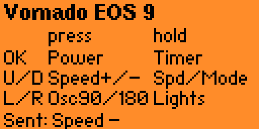

The [first post](/posts/vornado-eos-9-rf-remote-reverse-engineering/) ended
with a decode: a 32-bit frame, a 20-bit address, a one-hot command, no rolling
code. My plan was a CC1101 and an ESP32 that would put the fan on Home
Assistant. Before building that I wanted to know if the decode is enough on its
own. Can I make every button press from the 32-bit word, with no captured file
anywhere in the path? The Flipper already has the radio, so I made it the
fan's remote.

## An analyzer first

The first thing I asked for was not the remote. It was a tool for the step I
did by hand last time: capture a button, look at the pulse widths, guess OOK
or FSK. SubGHz Raw Analyzer captures 3 s with an OOK preset and 3 s with a 2FSK
preset, scores each one, and saves both as `.sub` files. Claude wrote the first
version in a chat that had no SDK, from API names it remembered. It had never
been compiled.

On the Mac mini, Claude Code built it with ufbt against the SDK for firmware
1.4.3, the version the Flipper reports over USB. Three errors:

```
error: 'subghz_device_cc1101_preset_ook_650khz_async_regs' undeclared
error: 'subghz_device_cc1101_preset_2fsk_dev238khz_async_regs' undeclared
error: unknown type name 'FuriHalRtcDateTime'
```

The first is a missing include, `lib/subghz/devices/cc1101_configs.h`. The
second is a name that never existed: the array is `..._2fsk_dev2_38khz_...`.
The third type was renamed `DateTime`. After that it built with no warnings and
passed ufbt's API check.

A clean build did not make it right. Claude Code read the firmware source at
the commit the Flipper reports and found three problems the compiler can't see:

- Up and Down could step the frequency into 348 to 387 MHz or 464 to 779 MHz,
  where the HAL calls `furi_crash`. Stepping now jumps the gaps. I checked
  every reachable frequency on the Mac against the HAL's own validity function.
- The "OK to stop" on the capture screen did nothing. The main loop is blocked
  for the whole capture, so the press was queued and saved a file the moment
  the results appeared.
- The noise score could not work. It counted pulses under 15 us, and the
  firmware's capture filter drops anything under about 16 us. I checked on the
  device: four seconds of background noise through the stock `subghz rx_raw`
  gave 32 pulses, the shortest 32 us. Both presets would have scored 0% noise,
  and the tie went to OOK every time.

The replacement scores the share of pulses that are at least 120 us long and
within about 20% of one of the three most common widths. A protocol uses a few
widths. Noise doesn't. With no remote in the room the app scored 41% for OOK
(3,149 pulses) and 44% for 2FSK (4,096 pulses, which filled the buffer in 0.7 s
of its 3 s window). That looked like room for a 60% line. It wasn't.

## The analyzer on the real remote

I held the fan's remote at the Flipper and ran it three ways. The real remote
also sends a stop mark after the 32 bits (a 1T mark and a 1T gap), which my
generated frames leave out and the fan does not miss. The numbers below
are from the saved captures, rescored on the Mac with the app's own formula.

| What I did | What the OOK pass caught | App's score |
|---|---|---|
| Held Power for 6 s | 23 identical copies of `0x035ED002` (Power) in 3 s | 62%, "Likely OOK" |
| Power, plus, minus | 8 Power frames and nothing else | 46%, no verdict |
| Power, three taps | Not saved; the screen showed 3,790 pulses | 48%, no verdict |

The first capture is perfect and the app barely called it. The score measures
how much of the 3 s window the remote fills, not whether what it sent is a
protocol, so a short tap scores worse than a long hold and a clean signal can
land under the line. The second run lost plus and minus because the 6 s is two
windows, and the second one is the 2FSK pass. It decoded zero frames in either
capture, with the button held, and its buffer was full of noise after 0.75 and
0.95 s. A 2FSK demodulator has nothing to say about an on-off carrier, and a
remote that sends once per press can never be in both windows anyway.

What the capture does contain is the thing to look for: the same frame, over
and over. Twenty-three of 23 identical in the good one, none in noise. That is
a test with no threshold to tune.

## Every frame built on the Flipper

The remote app has no capture files. It puts the 12-bit command under the
address and writes out the timings:

```c
/* T = 400 us. Positive = carrier on, negative = off. */
out[pos++] = T;  out[pos++] = -30 * T;                /* sync */
for(int i = 31; i >= 0; i--) {
    if((word >> i) & 1) { out[pos++] = 3 * T; out[pos++] = -T; }      /* 1 */
    else                { out[pos++] = T;     out[pos++] = -3 * T; }  /* 0 */
}
```

A press is eight of those frames back to back, 528 values, which by the
arithmetic is about half a second on air. The real remote sends four or five
frames per press. Eight is what the generated test file used when it turned the
fan on. Transmit is the same path the stock firmware's CLI uses: reset the
radio, load the OOK preset, set 433.92 MHz, start async TX with a callback the
HAL calls for each duration.

Before it went on the Flipper, the frame builder had to match
`gen_Power_VERIFY.sub` value for value. That is the file I built from the
decode last time and sent to the fan. It matched, and all ten commands decode
back to the right word.

## The key map

I suggested speed on Up and Down and oscillation on Left and Right, and left
the rest to Claude Code. It put the other four functions on long presses, so a
tap and a hold of the same key are different commands.

| Key | Tap | Hold |
|---|---|---|
| OK | Power | 12 hour timer |
| Up | Speed + | Fan Speeds |
| Down | Speed - | Airflow Modes |
| Left | Oscillation on/off | Lamp Mode |
| Right | Oscillation 90/180 | Light Settings |
| Back | Exit | Exit |

Claude Code wrote the spec and a cheaper sub-agent wrote the app from it. I
asked for it on the bike ride home.

## First run on the fan

Power, the timer and Selection + and - (which step the fan speed) did what the
map says. Holding Left sends Lamp Mode, which toggles: hold again and it goes
back.

The oscillation codes did not do what I had named them. The first post labelled
0x040 and 0x080 as Vornado's 90 and 180 degree buttons and said they might be
swapped. Sending 0x040 lights an indicator with up and down arrows on the fan's
front panel. Sending it again turns that off, and again turns it on. Sending
0x080 goes to 90, shown on the left of the panel, and each further press flips
between 90 and 180. So it is not a 90 button and a 180 button. It looks like
one control that turns oscillation on and off and one that picks the range. I
haven't watched which way the head moves for the first one. Vornado's guide
mentions a vertical oscillation control, and that is my guess for it. The
labels on the Flipper now say what the fan did.

The first screen had a second problem. To make the text fit I had squeezed both
long presses on Left and Right into one word, "Lights". I held Left, got Lamp
Mode, and could not tell from the screen whether that was right.



The new legend lists every key's tap and hold. It is built from the same
function that decides what a key sends, so the screen can't disagree with the
map.


## What the Flipper can't see

Every code here is one way. The fan doesn't answer, and most of these commands
are toggles or cycles, so the Flipper has no idea whether the lamp is on or
which oscillation is selected. The fan's own panel is the only display. With
the remote in my hand that is fine. For a gateway that puts the fan on Home
Assistant it is a real problem: it will need an assumed state, and the state
goes stale the first time somebody uses the physical remote. That is a design
question for the ESP32 box, and I would not have seen it from the decode alone.

## Not done yet

- The analyzer's score. It needs to look for repeated identical frames instead
  of counting pulses in a window, and the OOK then 2FSK passes should go.
- Which way the head moves for the oscillation on/off code, and what the three
  other long presses (Fan Speeds, Airflow Modes, Light Settings) do on the real
  fan.
- Whether Selection + and - follow the last function I pressed (Fan Speeds,
  Airflow Modes, Light Settings, Timer) or always change the speed.
- A tap during a send is dropped, and a send is about half a second. Queuing
  taps and cutting the burst to the remote's five frames would make speed
  changes feel right.
- The CC1101 and ESP32 gateway is still the plan. This is the version I can
  hold.

---

*[How this was built](/how-i-work/): Claude wrote the first analyzer in a chat
with no SDK. Claude Code on the Mac mini built it against the real SDK, read the
firmware source to find the runtime problems, and had a cheaper sub-agent write
the fan app from its spec. I set the goal (every frame built on the Flipper
from the decode), suggested speed on Up and Down and oscillation on Left and
Right, and ran the app against the real fan, which is what showed the
oscillation labels were wrong. Tested: the frame builder against the file that
turned the fan on; Power, Timer, Selection + and -, Lamp Mode and both
oscillation codes on the fan; the analyzer on background noise and on the real
remote, where its score was wrong. Not tested: the three other long presses, and
which way the head moves for the on/off code.*
